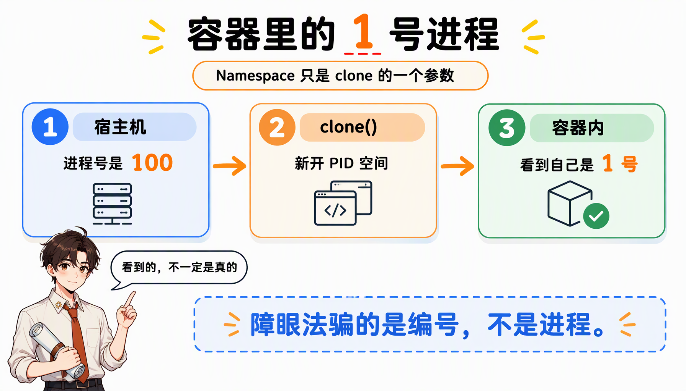

你在终端里敲下 `docker run -it ubuntu /bin/bash`，几秒钟后拿到一个“干净”的 Ubuntu：`ls /` 是完整的系统目录，`ps` 里除了容器里的自己再看不到别人，装崩了也不怕污染宿主机。

可就在同一台机器上，宿主机的 `ps` 明明能看到几百个进程；给容器限了 512MB 内存，`free` 里看到的却还是整台机器的内存。

这两处“不对劲”，恰好指向容器技术的全部秘密：**容器不是一台机器，而是一个被蒙住眼睛、拴住手脚的普通进程。**

要把它讲清楚，只需要回答三个问题：

- 它凭什么“看不见”外面的世界？—— **Namespace**，负责隔离；
- 它凭什么“用不到”多余的资源？—— **Cgroups**，负责限制；
- 它凭什么“到哪都一样”？—— **rootfs 与分层镜像**，负责一致性。

下面沿着这三条线索，从一行 `ps` 一直拆到镜像层。

## 一、先把“程序”变成“进程”

假如现在要写一个做加法的小程序：输入来自一个文件，算好的结果写到另一个文件。

计算机只认识 0 和 1，所以无论用哪种语言写，最后都要翻译成二进制文件，才能在操作系统里跑起来。而为了让代码正常跑，我们还得给它准备数据，也就是那个输入文件。二进制文件加上数据，躺在磁盘上，这就是我们平常说的“程序”。

那么，程序是怎么被“跑”起来的？

操作系统先从“程序”里发现输入数据保存在一个文件中，于是把它加载进内存待命；接着读到计算加法的指令，就指示 CPU 完成运算。CPU 和内存协作时，会用寄存器存放数值、用堆栈保存指令和变量。同时，进程还打开着文件，各种 I/O 设备也在调用中不断改变自己的状态。

于是，一旦“程序”被执行起来，它就从磁盘上的一个二进制文件，变成了内存里的数据、寄存器里的值、堆栈中的指令、被打开的文件，以及各种设备状态信息的集合。

**一个程序运行起来之后，计算机执行环境的总和，就是进程。**

对进程来说，静态表现是程序，安安静静地躺在磁盘上；动态表现则是运行起来后的数据和状态的总和。

容器技术的核心功能，恰恰是在这个“动态表现”上做文章：**通过约束和修改进程的动态表现，为它创造出一个“边界”。**

对 Docker 这类 Linux 容器来说，两件工具各管一头：

| 工具 | 作用 | 一句话理解 |
| :--- | :--- | :--- |
| Namespace | 修改进程视图 | 让你“看不见” |
| Cgroups | 制造资源约束 | 让你“用不多” |

## 二、隔离：给进程施一个“障眼法”

先跑一个最小的容器：

```bash
$ docker run -it busybox /bin/sh
/ #
```

`docker run` 是 Docker 项目最重要的一个操作。`-it` 告诉 Docker，启动容器后要分配一个文本输入 / 输出环境（也就是 TTY），并接到容器的标准输入上，这样我们才能和容器交互；`/bin/sh` 则是要在容器里运行的程序。

翻译成人话就是：请帮我启动一个容器，在里面执行 `/bin/sh`，再给我一个终端跟它对话。

这样，你的机器成了宿主机，而一个运行着 `/bin/sh` 的容器，就跑在了这个宿主机里面。

此时在容器里执行一下 `ps`，会看到一些挺有意思的东西：

```text
/ # ps
PID   USER   TIME   COMMAND
    1 root   0:00   /bin/sh
   10 root   0:00   ps
```

最开始执行的 `/bin/sh`，成了这个容器内部的 1 号进程；整个容器里只有两个进程在跑。也就是说，`/bin/sh` 和刚敲下的 `ps`，已经被 Docker 隔离在了一个跟宿主机完全不同的世界当中。

这究竟是怎么做到的？

本来，每当在宿主机上运行一个 `/bin/sh`，操作系统都会给它分配一个进程编号，比如 PID=100。这个编号是进程的唯一标识，就像员工的工牌。PID=100 可以粗略理解成公司里的第 100 号员工，而 1 号员工自然是比尔·盖茨那样统领全局的人物。

现在 Docker 把这个 `/bin/sh` 装进容器，相当于在第 100 号员工入职时给他施了一个“障眼法”：让他永远看不到前面的 99 个员工，更看不到比尔·盖茨。于是他会错误地以为，自己就是公司里的 1 号员工。

这种机制，其实就是对被隔离应用的进程空间“做了手脚”，让这些进程只能看到重新计算过的进程编号，比如 PID=1；可实际上，它们在宿主机的操作系统里，还是原来的第 100 号进程。

**这种技术，就是 Linux 的 Namespace。**



而 Namespace 的使用方式也挺有意思：它其实只是 Linux 创建新进程时的一个可选参数。Linux 创建进程的系统调用是 `clone()`：

```c
int pid = clone(main_function, stack_size, SIGCHLD, NULL);
```

这个调用会创建一个新进程并返回它的进程号。而当我们用 `clone()` 创建新进程时，可以在参数里指定 `CLONE_NEWPID`：

```c
int pid = clone(main_function, stack_size, CLONE_NEWPID | SIGCHLD, NULL);
```

这时，新创建的进程会“看到”一个全新的进程空间，在这个空间里它的 PID 是 1。注意“看到”这两个字：这只是一层障眼法，在宿主机真实的进程空间里，它的 PID 还是原来的数值，比如 100。

多次执行上面的 `clone()` 调用，就能创建多个 PID Namespace。每个 Namespace 里的应用进程，都认为自己是当前容器里的 1 号进程；它们既看不到宿主机真正的进程空间，也看不到其他 PID Namespace 里的具体情况。

除了 PID Namespace，Linux 还提供了另外一组 Namespace，各自负责对一个维度的进程上下文做“障眼法”：

| Namespace | 隔离的内容 | 容器里的典型表现 |
| :--- | :--- | :--- |
| PID | 进程编号 | `ps` 只看得到自己，自己是 1 号 |
| Mount | 挂载点 | 有自己的 `/`，看不到宿主机的挂载 |
| UTS | 主机名与域名 | 可以有独立的 hostname |
| IPC | 进程间通信 | 信号量、消息队列互不可见 |
| Network | 网络设备、协议栈、端口 | 有自己的网卡、IP 和端口空间 |
| User | 用户与用户组 ID | 容器里的 root 可以不是宿主机的 root |
| Time | 系统时钟（Linux 5.6 起） | 容器内可以有独立的时钟偏移 |

> [!NOTE]
> Time Namespace 是后来才加进内核的。2018 年讲容器时还没有它，所以很多老资料里只列前六个。

**到这里可以下第一个结论：Docker 容器这个听起来玄而又玄的概念，实际上是在创建容器进程时，指定了这个进程所需要启用的一组 Namespace 参数。** 这样，容器就只能“看”到当前 Namespace 所限定的资源、文件、设备、状态或者配置；对于宿主机以及其他不相关的程序，它完全看不到。

所以：**容器，说到底是一种特殊的进程。**

Namespace 修改的是应用进程看待整台计算机的“视图”——它的“视线”被操作系统限制住了，只能看到某些指定的内容。

## 三、限制：给进程戴上“紧箍咒”

### 3.1 只有隔离，为什么还不够

也许你会好奇：不是已经用 Namespace 造出一个“容器”了吗，为什么还要限制它？

还是以 PID Namespace 为例。容器里的 1 号进程被障眼法骗住了，但在宿主机上，它作为 100 号进程，与其他所有进程之间依然是平等的竞争关系。这意味着，它虽然“表面上”被隔离了，但能使用到的资源（比如 CPU、内存）随时可能被宿主机上的其他进程或者其他容器抢走；反过来，它自己也可能把所有资源吃光。

一个沙盒如果连“你能用多少”都管不住，那显然不是个合格的沙盒。

### 3.2 Cgroups：内核级的资源配额

**Linux Cgroups 就是内核中用来为进程设置资源限制的功能。**

Cgroups 的全称是 Linux Control Group。它最主要的作用，是限制一个进程组能够使用的资源上限，包括 CPU、内存、磁盘、网络带宽等等。此外，它还能对进程做优先级设置、审计，以及挂起和恢复。这里我们只关心和容器关系最紧密的“限制”能力。

在 Linux 中，Cgroups 给用户暴露出来的操作接口是文件系统：它以文件和目录的方式，组织在 `/sys/fs/cgroup` 路径下。

**Cgroups 的设计其实挺易用，简单粗暴地理解，它就是一个子系统目录加一组资源限制文件的组合。** 对 Docker 这类容器项目来说，要做的只是在每个子系统下面为每个容器创建一个控制组（即新建一个目录），然后在启动容器进程之后，把这个进程的 PID 填进对应控制组的 `tasks` 文件。

至于资源文件里填什么值，就靠执行 `docker run` 时的参数指定了。比如：

```bash
$ docker run -it --cpu-period=100000 --cpu-quota=20000 ubuntu /bin/bash
```

容器启动后，去 Cgroups 文件系统里看一眼 CPU 子系统中 `docker` 控制组下的资源限制文件：

```bash
$ cat /sys/fs/cgroup/cpu/docker/5d5c9f67d/cpu.cfs_period_us
100000

$ cat /sys/fs/cgroup/cpu/docker/5d5c9f67d/cpu.cfs_quota_us
20000
```

`period` 是调度周期，`quota` 是周期内可用的额度。100ms 的周期里最多用 20ms 的 CPU 时间——**也就是说，这个容器最多只能用到 20% 的 CPU 带宽**（严格说是单个 CPU 核心的 20%）。

> [!NOTE]
> 上面的路径是 Cgroups v1 的布局。今天多数发行版已经默认 Cgroups v2，同样的限制会落在 `/sys/fs/cgroup/<group>/cpu.max` 里，内容形如 `20000 100000`。目录结构变了，模型没变：仍然是“给一组进程划定额度”。

## 四、一致性：rootfs 与镜像分层

隔离解决“看不见”，限制解决“用不多”，但容器要跑起来，还得先有一套属于自己的文件系统。

### 4.1 rootfs：容器的“躯壳”

我们一般会在这个容器的根目录下，挂载一个完整操作系统的文件系统，比如一份 Ubuntu 16.04 的 ISO。这样容器启动之后，执行 `ls /`，看到的就是 Ubuntu 的全部目录和文件：

```text
/ # ls /
bin  boot  dev  etc  home  lib  lib64  media  mnt  opt  proc  root  run  sbin  srv  sys  tmp  usr  var
```

这个挂载在容器根目录上、用来为容器进程提供隔离后执行环境的文件系统，就是所谓的“容器镜像”。它还有一个更专业的名字：**rootfs（根文件系统）**。

一个最常见的 rootfs 会包括 `/bin`、`/etc`、`/proc` 等等目录和文件。而你进入容器之后执行的 `/bin/bash`，就是这套 rootfs 里 `/bin` 目录下的可执行文件，与宿主机的 `/bin/bash` 完全是两个文件。

现在应该可以理解，对 Docker 项目来说，它最核心的原理实际上就是为待创建的用户进程：

1. 启用一组 Linux Namespace 配置；
2. 设置指定的 Cgroups 参数；
3. 切换进程的根目录（change root，具体实现是 `chroot` 或 `pivot_root`）。

需要明确的是：**rootfs 只是一个操作系统所包含的文件、配置和目录，并不包括操作系统内核。** 在 Linux 中这两部分是分开存放的，内核镜像只在开机启动时才会加载。

所以说，rootfs 只包含了操作系统的“躯壳”，并没有包含它的“灵魂”。

那么，容器的“灵魂”在哪里？

实际上，**同一台机器上的所有容器，都共享宿主机操作系统的内核。**

这就意味着：如果你的应用需要配置内核参数、加载额外的内核模块，或者与内核直接交互，就得注意了——这些操作和依赖的对象都是宿主机内核，它对这台机器上的所有容器来说是一个“全局变量”，牵一发而动全身。

这也是容器相比于虚拟机的主要缺陷之一：虚拟机不仅有模拟出来的硬件机器充当沙盒，每个沙盒里还跑着一个完整的 Guest OS，让应用在里面随便折腾；容器没有这层硬件边界。

不过，**正是由于 rootfs 的存在，容器才有了一个被反复宣传至今的重要特性：一致性。**

云端与本地服务器环境不同，应用的打包过程一直是使用 PaaS 时最“痛苦”的一个步骤。有了容器、更准确地说有了容器镜像（也就是 rootfs）之后，这个问题被非常优雅地解决了：

**rootfs 里打包的不只是应用，而是整个操作系统的文件和目录。应用的代码，以及它运行所需要的所有依赖，被一起封装在了镜像里。**

这种深入到操作系统级别的运行环境一致性，打通了应用在本地开发和远端执行环境之间那道难以逾越的鸿沟。这正是 PaaS 一直以来最理想的状态：应用被打包成标准集装箱，封条一贴，到哪台机器上都按同样的方式装卸。

### 4.2 为什么镜像必须分层

讲完一致性，一个很现实的问题冒出来了：难道每开发一个应用、每升级一次，都要从头做一份 rootfs？

比如我用 Ubuntu 的 ISO 做了个 rootfs，又在里面装了 Java 环境来部署 Java 应用。那么同事发布他的 Java 应用时，显然希望直接复用这个装好 Java 的 rootfs，而不是把流程重走一遍。

最直观的办法是：每做一步“有意义”的操作，就保存一份完整的 rootfs，其他同事按需取用。

但这办法没法推广：只要同事在你的 rootfs 上改了一点东西，新旧两份 rootfs 就再没有任何关系了，结果就是极度的碎片化——同一个底座被 fork 出无数份互不相干的副本。

既然这些修改都基于同一个旧 rootfs，能不能只记录“增量”？这样一来，所有人只需要维护相对于 base rootfs 的修改，而不是每次改动都造一个新的 fork。

答案当然是肯定的。这也正是 Docker 在实现镜像时做的一个小小的创新：

> Docker 在镜像的设计中引入了**层（layer）** 的概念。用户制作镜像的每一步操作，都会生成一个层，也就是一个增量 rootfs。

这个想法不是凭空来的，它用到了另一种叫**联合文件系统（UnionFS）** 的能力。

UnionFS 最主要的功能，是把多个不同位置的目录联合挂载（union mount）到同一个目录下。比如现在有两个目录 A 和 B，各自有两个文件：

```text
$ tree
.
├── A
│   ├── a
│   └── x
└── B
    ├── b
    └── x
```

然后用联合挂载的方式，把这两个目录挂到一个公共目录 C 上：

```bash
$ mkdir C
$ mount -t aufs -o dirs=./A:./B none ./C
```

再看目录 C，A 和 B 下的文件已经被合并到了一起：

```text
$ tree ./C
./C
├── a
├── b
└── x
```

注意 `x` 只出现了一次。两个目录里都有同名文件时，`dirs` 中排在前面的 A 优先级更高，所以看到的是 A 的 `x`。**“同名文件谁赢”这条规则很关键，下面 whiteout 的删除机制正是建立在它之上的。**

### 4.3 一个容器的 rootfs 到底长什么样

以 AuFS 为例，它最关键的目录结构在 `/var/lib/docker` 路径下的 diff 目录：

```text
/var/lib/docker/aufs/diff/<layer_id>
```

这个目录的作用，不妨通过一个具体例子来看。启动一个容器：

```bash
$ docker run -d ubuntu:latest sleep 3600
```

Docker 会从 Docker Hub 拉取一个 Ubuntu 镜像到本地。这个所谓的“镜像”，实际上就是一份 Ubuntu 操作系统的 rootfs，内容是 Ubuntu 的所有文件和目录。不过，它与前面说的“一份完整 rootfs”略有不同：Docker 镜像使用的 rootfs 往往由多个“层”组成。

```bash
$ docker image inspect ubuntu:latest
...
    "RootFS": {
      "Type": "layers",
      "Layers": [
        "sha256:f49017d4d5ce9c0f544c...",
        "sha256:8f2b771487e9d6354080...",
        "sha256:ccd4d61916aaa2159429...",
        "sha256:c01d74f99de40e097c73...",
        "sha256:268a067217b5fe78e000..."
      ]
    }
```

可以看到，这个 Ubuntu 镜像实际上由五个层组成。这五个层就是五份增量 rootfs，每一层都是 Ubuntu 文件与目录的一部分；使用镜像时，Docker 会把这些增量联合挂载到一个统一的挂载点上（等价于前面例子里的 `./C` 目录）。

这个挂载点就是 `/var/lib/docker/aufs/mnt/`，比如：

```text
/var/lib/docker/aufs/mnt/6e3be5d2ecccae7cc0fcfa2a2f5c89dc21ee30e166be823ceaeba15dce645b3e
```

不出意外，这个目录里正是一套完整的 Ubuntu 操作系统：

```bash
$ ls /var/lib/docker/aufs/mnt/6e3be5d2ecccae7cc0fcfa2a2f5c89dc21ee30e166be823ceaeba15dce645b3e
bin  boot  dev  etc  home  lib  lib64  media  mnt  opt  proc  root  run  sbin  srv  sys  tmp  usr  var
```

那么，前面那五个镜像层，又是怎么被联合挂载成这样一个完整文件系统的？

这个信息记录在 AuFS 的系统目录 `/sys/fs/aufs` 下面。首先，通过挂载信息找到这个目录对应的 AuFS 内部 ID（也叫 si）：

```bash
$ cat /proc/mounts | grep aufs
none /var/lib/docker/aufs/mnt/6e3be5d2ecccae7cc... aufs rw,relatime,si=972c6d361e6b32ba,dio,dirperm1 0 0
```

即 `si=972c6d361e6b32ba`。用这个 ID，就可以在 `/sys/fs/aufs` 下查看被联合挂载在一起的各个层：

```bash
$ cat /sys/fs/aufs/si_972c6d361e6b32ba/br[0-9]*
/var/lib/docker/aufs/diff/6e3be5d2ecccae7cc...=rw
/var/lib/docker/aufs/diff/6e3be5d2ecccae7cc...-init=ro+wh
/var/lib/docker/aufs/diff/32e8e20064858c0f2...=ro+wh
/var/lib/docker/aufs/diff/2b8858809bce62e62...=ro+wh
/var/lib/docker/aufs/diff/20707dce8efc0d267...=ro+wh
/var/lib/docker/aufs/diff/72b0744e06247c7d0...=ro+wh
/var/lib/docker/aufs/diff/a524a729adadedb90...=ro+wh
```

从这些信息里可以看到：镜像的层都放在 `/var/lib/docker/aufs/diff` 目录下，然后被联合挂载到 `/var/lib/docker/aufs/mnt` 里面。

`br` 是 AuFS 的 branch，这七行输出从上到下就是容器的层叠顺序。从结构可以看出，**一个运行中的容器的 rootfs 由三部分组成**：

| 层（从上到下） | 挂载方式 | 层数 | 里面放着什么 |
| :--- | :--- | :--- | :--- |
| 可读写层 | `rw` | 1 | 容器运行期间产生的所有增、删、改 |
| Init 层 | `ro+wh` | 1 | `/etc/hosts`、`/etc/hostname`、`/etc/resolv.conf` |
| 只读层 | `ro+wh` | 5 | `ubuntu:latest` 镜像本身的五个增量层 |

七层联合挂载到一起，就是一套完整的 Ubuntu。


#### 只读层

它是这个容器 rootfs 最下面的五层，对应的正是 `ubuntu:latest` 镜像的五层。可以看到，它们的挂载方式都是只读的（`ro+wh`，即 readonly + whiteout；whiteout 是什么，下面马上讲）。

分别查看一下这些层的内容：

```bash
$ ls /var/lib/docker/aufs/diff/72b0744e06247c7d0...
etc  sbin  usr  var

$ ls /var/lib/docker/aufs/diff/32e8e20064858c0f2...
run

$ ls /var/lib/docker/aufs/diff/a524a729adadedb900...
bin  boot  dev  etc  home  lib  lib64  media  mnt  opt  proc  root  run  sbin  srv  sys  tmp  usr  var
```

可以看到，每一层都以增量的方式，只包含了 Ubuntu 操作系统的一部分。

#### 可读写层

它是这个容器 rootfs 最上面的一层（`6e3be5d2ecccae7cc`），挂载方式为 `rw`，即 read write。在没有写入文件之前，这个目录是空的；一旦在容器里做了写操作，修改产生的内容就会以增量的方式出现在这一层。

可是，你有没有想到这样一个问题：如果现在要做的，是删除只读层里的一个文件呢？只读层改不了，也删不掉。

为了让删除生效，AuFS 会在可读写层创建一个 whiteout 文件，把只读层里的文件“遮挡”起来。

比如要删除只读层里一个名叫 `foo` 的文件，这个删除操作实际上是在可读写层创建了一个名叫 `.wh.foo` 的文件。当两个层被联合挂载之后，`foo` 就会被 `.wh.foo` 挡住，“消失”了。这就是 `ro+wh` 的含义：只读 + whiteout。

所以最上面这个可读写层的作用很明确：专门存放你对 rootfs 修改后产生的增量，无论是增、删、改，都发生在这里。而容器使用完之后，还可以用 `docker commit` 和 `push` 保存这个被修改过的可读写层，并上传到 Docker Hub 供其他人使用；与此同时，原先只读层里的内容不会有任何变化。

**这，就是增量 rootfs 的好处：改的是增量，共享的是底座。**

> [!TIP]
> `docker commit` 更像给容器拍一张快照，适合实验和排障；日常构建镜像还是用 Dockerfile，让每一条指令对应一个可复现的层。

#### Init 层

它是一个以 `-init` 结尾的层，夹在只读层和读写层之间。Init 层由 Docker 项目单独生成，专门用来存放 `/etc/hosts`、`/etc/hostname`、`/etc/resolv.conf` 这些文件。

之所以需要这样一层，是因为这些文件本来属于只读的 Ubuntu 镜像，但用户往往需要在启动容器时写入指定值，比如 hostname。也就是说，需要在可读写层对它们进行修改。

可这些修改往往只对当前容器有效，我们并不希望执行 `docker commit` 时，把它们连同可读写层一起提交出去。

Docker 的做法是：修改完这些文件之后，把它们单独挂成一个层。用户执行 `docker commit` 只会提交可读写层，所以并不包含这些内容。

最终，5 个只读层、1 个 Init 层、1 个可读写层，共七个层被联合挂载到 `/var/lib/docker/aufs/mnt` 目录下，表现为一套完整的 Ubuntu 操作系统，供容器使用。

> [!NOTE]
> 以上路径都发生在 Linux 宿主机上。如果你用的是 Docker Desktop（macOS / Windows），这些目录位于 Docker Desktop 内部的虚拟机里，在你的 macOS 文件系统里是看不到的。

### 4.4 一点补注：AuFS 已经退场，overlay2 接班

上面这一整套分析是 AuFS 时代的产物。AuFS 一直没能进入 Linux 主线内核，所以现代 Docker 默认换成了 **overlay2**（Docker 17.06 之后逐渐成为默认的存储驱动）。

实现换了，概念一点没换：

| 对比项 | AuFS | overlay2 |
| :--- | :--- | :--- |
| 层目录 | `/var/lib/docker/aufs/diff/<id>` | `/var/lib/docker/overlay2/<id>/diff` |
| 联合挂载点 | `/var/lib/docker/aufs/mnt/<id>` | `/var/lib/docker/overlay2/<id>/merged` |
| whiteout 的实现 | `.wh.foo` 普通文件 | 设备号为 0/0 的字符设备 |
| 分层模型 | 多个增量层 | 完全一样 |

可以在自己的机器上确认一下：

```bash
$ docker info | grep -i "storage driver"
 Storage Driver: overlay2
```

所以读这篇时，不妨把 AuFS 当成一具“解剖标本”：它把联合挂载和分层的原理展示得最直白。理解之后换成 overlay2，你看到的仍然是同一套东西——只读层叠出底座，可读写层兜住增量，Init 层处理那些不该进镜像的配置。

## 五、收尾：容器是特殊的进程，不是迷你的虚拟机

把三件事放在一起，Docker 的核心原理其实就是三步：

1. **Namespace**：创建进程时搭起一组 Namespace，决定它“能看到什么”；
2. **Cgroups**：把进程 PID 写进控制组，决定它“最多用多少”；
3. **rootfs**：把一套完整操作系统的文件目录挂到它的根目录上，决定它“跑在什么环境里”。

所以容器从来不是“一台小机器”，而是一个被限制了视线、限制了资源、指定了根目录的进程。

这解释了它和虚拟机的全部差别：

| 维度 | 容器 | 虚拟机 |
| :--- | :--- | :--- |
| 隔离单位 | 进程 | 虚拟机（虚拟硬件 + Guest OS） |
| 内核 | 与宿主机共享同一个内核 | 每个虚拟机各自一个内核 |
| 启动速度 | 毫秒到秒级 | 秒到分钟级 |
| 镜像体积 | MB 级（只有文件和目录） | GB 级（含完整操作系统） |
| 隔离强度 | 弱：共享内核，内核漏洞可能逃逸 | 强：硬件虚拟化边界 |

由此带来三条实践上的提醒：

- **镜像里不该有内核**，在容器里改内核参数，动的也是宿主机的内核，影响的是这台机器上的所有容器；
- **容器里的 root 默认就是宿主机的 root**（除非启用 User Namespace 重映射），而共享内核又意味着一旦内核被攻破隔离即告失效，别把容器当成强安全边界；
- **一致性的边界止于内核**，所以“本地能跑线上不能跑”里的内核版本、`sysctl`、Cgroups 版本这类差异，容器兜不住。

最后，把全文压成一句话：

> 容器 = Namespace（看不见）+ Cgroups（用不多）+ rootfs（到处一样），三样一起作用在一个普通进程身上。
