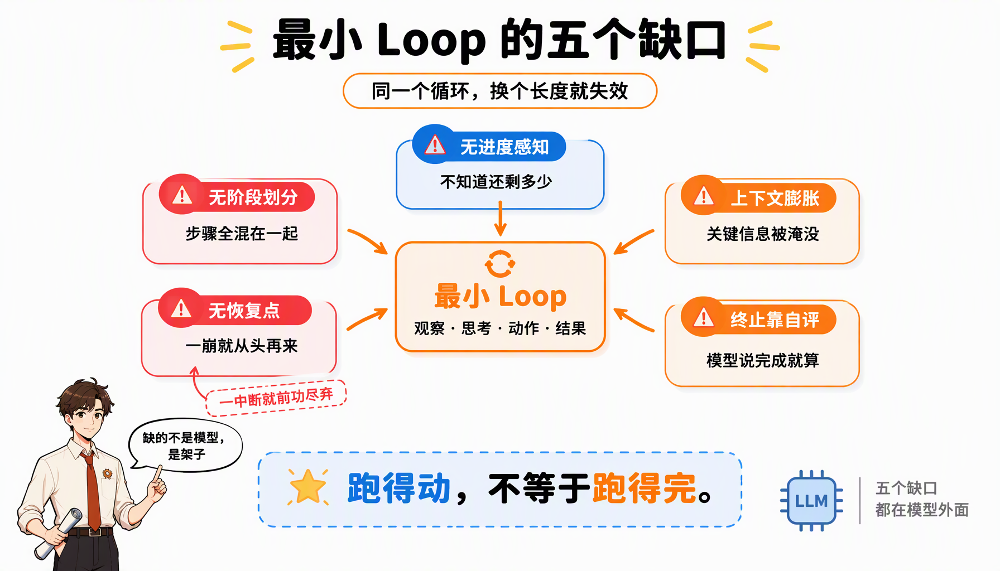
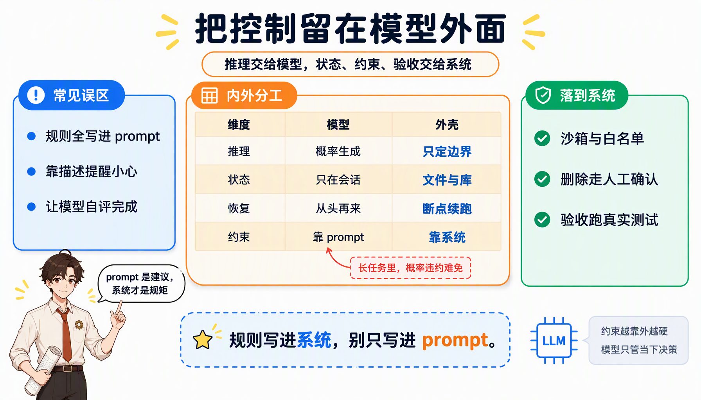
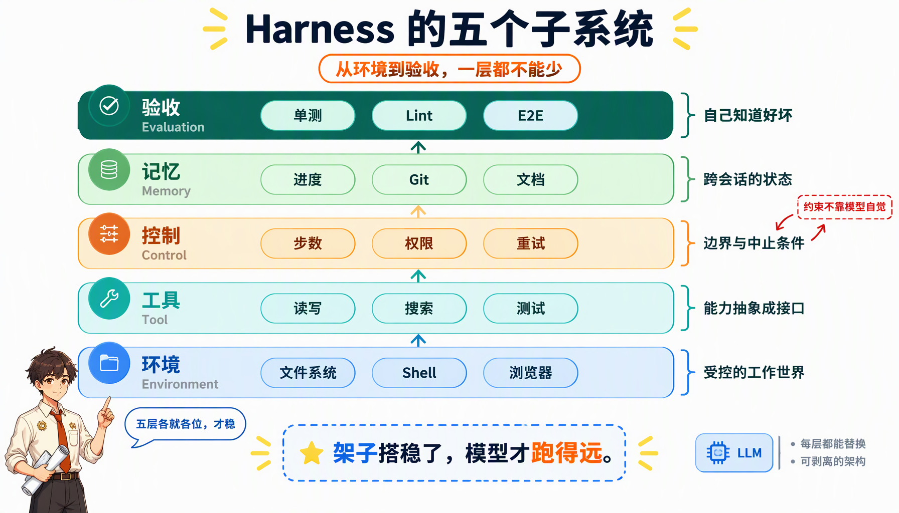
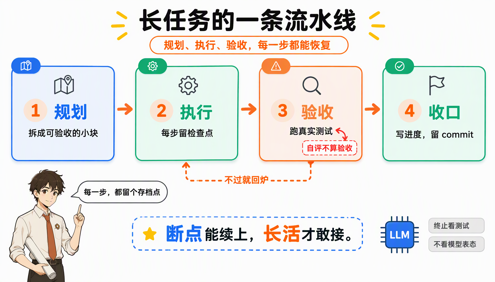

周五下班前，你让 Agent 把一次跨 20 个文件的重构做完。

前十分钟它表现惊艳：读代码、列计划、改文件、跑测试，每一步都像那么回事。周一回来，会话断了，它不记得昨天改到哪，开始重复修改已经改过的文件；测试挂了，它说“看起来没问题”；你花了一整个晚上收拾残局，最后发现手写可能更快。

这不是模型不聪明。它只是没有被放进一个能长期工作的架子里。

**Agent = Model + Harness**。与其说这是一个公式，不如说它是一个拆解问题的角度：模型决定能力的上限，Harness 决定这个上限能兑现多少、能撑多久。这篇文章想讲清楚四件事：

- Harness 到底是什么，和 Agent 框架、Prompt 工程的分界线在哪；
- 为什么最小 Agent Loop 在 Demo 里能跑，在生产里会崩；
- 一个能跑长任务的 Harness，需要哪些确定性机制；
- 哪些反模式最容易把团队带进沟里。

> [!TIP]
> 一句话版本：模型负责想，工程负责兜底。长任务不稳，先别急着换模型，先看架子。

## 为什么 Demo 惊艳，上线就崩

把 Agent 放进真实生产，几乎所有团队都会撞上同一组问题：

- **Demo 惊艳，上线即崩**：循环卡死、工具乱用、任务半途而废；
- **跨天长任务无法延续**：一断会话就“失忆”；
- **代码库被 AI 写碎**：风格不一致、架构漂移、测试常挂；
- **审计与回溯不可能**：出了问题，不知道从哪一步开始跑偏。

这些问题的共同点是：和模型参数关系不大，和模型外面的工程系统关系很大。

模型 API 的形态是“请求 → 响应”，一次调用回答一个问题。真实任务却是一条链路：理解需求、拆解、执行、验证、修复、交付。链路越长，不确定性越多；不确定性越多，越需要外面的系统提供结构。Demo 只需要证明“能做”，生产需要证明“每次都能做完”。

## Harness 到底是什么

**Harness 是包裹在模型外部，让模型能够在真实环境里长期、安全、可控地执行任务的那层系统。**

正式一点说：

> 围绕 LLM / Agent 构建的确定性控制系统：在不确定的模型之上，提供状态、约束、工具、记忆与验收，使复杂任务可以被长期、可恢复、可审计地完成。

这句话里有四个关键词：

- **模型外部**：不是 Prompt，也不是微调，而是模型之外那层代码与基础设施；
- **确定性**：同样的输入，行为可预期，不依赖模型“这次心情好不好”；
- **长期**：跨步骤、跨会话、跨天，任务不会因为一次中断就归零；
- **可恢复、可审计**：出错能回滚，过程能复盘，责任能定位。

所以 Harness 不是某个库。一个完整的 Harness 通常要覆盖以下几类能力：

- **系统提示与上下文注入**：角色、目标、当前任务状态、技能说明；
- **工具与执行环境**：文件系统、Bash、语言运行时、浏览器、API、MCP；
- **控制与编排**：调用顺序、循环结构、中止条件、配额限制；
- **持久化与状态管理**：进度文件、任务状态、日志、Git 历史；
- **观察与验证**：测试结果、日志、浏览器截图、监控指标与审计。

这些能力在架构上通常会落成五个子系统，后文会展开。

### 一个熟悉的类比：Agent 的“计算机四件套”

把 Agent 系统拆成计算机的几件套，会更容易看清各层的职责：

| 类比         | 对应                 | 作用                                             |
| :----------- | :------------------- | :----------------------------------------------- |
| **CPU**      | Model                | 算力与决策                                       |
| **内存**     | 上下文窗口           | 短时工作区                                       |
| **操作系统** | Harness Runtime      | 资源管理、进程调度、约束、I/O、恢复              |
| **应用程序** | Agent 应用           | 跑在运行时之上、面向业务的具体智能体             |

需要说明的是，这里的“应用程序”指的是面向业务的具体实例，而不是公式里那个抽象的 Agent 组合。类比的目的是提醒你：**模型再强，也需要一个运行时替它管理资源、隔离风险、保存状态。**

模型决定“上限能做什么”，Harness 决定“实际能做成多少、能撑多久”。

### Harness 不是框架

这是最容易被混淆的一点。

框架解决的是“怎么把模型接进系统”，Harness 解决的是“接进去之后，这件事能不能稳定做完”。LangGraph、AutoGen、Deep Agents 这些框架会给你一套现成的脚手架，但下面这些东西，框架替不了你：

- 你的任务状态长什么样、存在哪、怎么恢复；
- 你的工具协议、权限边界和失败语义；
- 你的验收标准：什么才算“做完了”；
- 你的审批节点：哪些操作必须人来拍板。

一个实用的判断标准是：**换掉框架之后，任务状态、工具协议、验收标准还在不在？** 如果换框架等于推倒重来，那你拥有的是框架，不是 Harness。

Manus 团队在早期复盘里提到，他们的 Agent 框架被反复重构；Vercel 则直接砍掉了 80% 的工具。这些动作看起来像返工，其实是在做同一件事：模型能力变了，Harness 必须能跟着变薄。

### 和 Prompt / Context Engineering 的分界

这三个词经常被混着用，其实回答的是不同层级的问题：

- **Prompt Engineering**：在一次调用里，把话说清楚——角色、指令、示例、输出格式；
- **Context Engineering**：在每次调用时，决定塞进哪些信息——检索什么、保留什么、压缩什么；
- **Harness Engineering**：在整条任务链上，决定谁来控制——状态存哪、失败怎么恢复、什么算完成、哪些操作必须人批。

一句话：Prompt 是话术，Context 是视野，Harness 是制度。

### 和传统软件工程的关系

Harness Engineering 不是另一套方法论，它更像是传统软件工程在“执行体不确定”前提下的变体。

相同点很直接：关注结构化知识、架构边界、可观测性、测试、回滚、人机协作；用代码、配置、规则、文档来保证系统在复杂环境下稳定运行。

差异则集中在执行体上：

- **核心执行体**：传统软件工程是确定性代码，给定输入可以静态分析；Harness 的核心是概率性的 LLM，会幻觉，对隐含约束的理解不稳定。
- **推理与控制**：传统把逻辑与控制都写在代码里；Harness 把推理留在模型内部，把控制（状态机、检查点、回滚、重试）留在外壳。
- **状态管理**：传统管理内存与存储对象；Harness 还要管理“语言上下文”（对话、RAG 文档、工具描述），决定哪些持久化、哪些动态注入。
- **评估与验收**：传统靠单元测试、集成测试和 Code Review；Harness 还要用 evaluator + 工具（Playwright、日志查询）做自我 QA，evaluator 本身也要单独调教。

软件工程假定核心逻辑是确定的，不确定性主要在输入与外界；Harness 假定**核心执行者是概率性的、会犯错**，工程目标从“让程序按 spec 跑”变成“**在一个不可靠但很聪明的执行体上，构建可靠系统**”。

## 先看清模型：一个没有状态的函数

从接口看，模型就是一个函数：

```text
next_action = model(context)
```

给一段上下文，返回下一段文本或一个工具调用。它没有副作用，不记得上一次调用，也不知道自己运行在哪台机器上。

因此，模型天然缺四样东西：

- **长期记忆**：只看得见当前上下文窗口；
- **执行能力**：不能直接运行代码、读写文件、访问网络；
- **状态持久化**：每次调用都是一次“无状态求值”；
- **安全隔离**：不知道哪些操作危险，也没有“权限”这个概念。

任何“超越函数本身”的行为，都必须由 Harness 补上：

| 你想让 Agent…        | Harness 需要提供…          |
| :------------------- | :------------------------- |
| 记住昨天改过哪个文件 | 状态写到文件或数据库       |
| 真的跑测试           | 可控的代码执行环境         |
| 不无限循环           | 步数、时间、状态机约束     |
| 挂了之后能恢复       | 任务日志和恢复流程         |
| 不乱删东西           | 沙箱、白名单、人工确认     |

模型不是不会推理，而是它的推理没有记忆、没有手脚、没有边界。这三件事，恰好都是工程问题。

## 最小 Agent Loop：Demo 能跑，生产会崩

很多 Agent 框架都可以抽象成一个很短的循环：

```python
while not finished:
    observation = environment()
    thought = model(observation)
    action = choose_action(thought)
    result = run_tool(action)
    update_state(result)
```

这段伪代码在短任务里表现尚可，但每一行都藏着一个假设：

- `finished` 由谁判断？通常是模型自己；
- `observation` 只是当前上下文，历史越多，关键信息越模糊；
- `choose_action` 是概率采样，不是规则；
- `run_tool` 失败时，通常只返回一行错误字符串；
- `update_state` 更新的是进程内存，进程一退就没了。

短任务步骤少、状态浅、错了还能重来，所以这些假设看不出问题。任务一旦拉长，它们会同时失效：

| 缺陷               | 在长任务里的表现                                             |
| :----------------- | :----------------------------------------------------------- |
| **无进度感知**     | 不知道完成度、剩余工作量，无法做资源预测和用户反馈           |
| **无阶段划分**     | 理解需求、设计、实现、验收混在一起，步骤之间互相污染         |
| **无恢复点**       | 错误只回到模型，可能在错误路径上一错再错；单次崩溃就报废     |
| **终止靠模型自评** | 容易“还没做完就宣布完成”，或者“已经完成还在瞎忙”             |
| **上下文膨胀**     | 历史对话、工具输出越积越多，关键信息被淹没（context rot）     |



> [!WARNING]
> 这些缺口有一个共同点：它们都发生在模型外面。换更强的模型能缓解症状，但补不上结构。

## 核心设计哲学：确定性外壳，概率内核

总体模式可以用一句话概括：

> **用一个尽可能确定性的外壳，包裹一个有能力但非确定的模型内核，让系统整体表现出可预测、可恢复、可审计的行为。**

- **内核（LLM）**：自然语言理解与生成、复杂规划与抽象、代码生成与文档撰写。
- **外壳（Harness）**：任务生命周期管理（Task Loop / State Machine）、资源预算与限流、错误分类与重试回滚、状态持久化与检查点、工具权限与安全策略、审批节点与人机协作。



### 最常见的误区：把所有逻辑都 Prompt 化

“请不要删除文件”“谨慎调用这个接口”“记得先跑测试”。

这些话写在系统提示里，在短对话里往往有效。但在几百步的长任务里，**概率性违约几乎不可避免**：模型不是不听话，而是它对同一句话的注意力会随着轮次衰减。

所以有一条原则值得反复强调：

> **凡是能用确定性机制表达的约束，就不要只写在 Prompt 里。**

具体一点：

- 文件读写范围：用 sandbox + allowlist 控制，而不是写“请不要访问 `/etc`”；
- 删除操作：走单独的工具 + 人工确认，而不是写“删除前请三思”；
- 网络访问：通过 MCP / Tools 白名单过滤，而不是写“不要访问陌生域名”；
- 提交规范：在 CI 里强制跑测试，而不是写“提交前请运行测试”。

Prompt 里应该写“为什么”和“上下文”，**“必须”交给系统**。这个分工一旦反过来，Harness 就退化成了一份愿望清单。

### 状态机：把 Task Loop 搬到模型外面

Task Loop 不应该是模型脑子里的一段即兴表演，而应该是一个显式状态机：运行在模型外部，由控制层驱动，模型只在特定状态被调用，执行“思考 + 生成”。

```python
from enum import Enum


class TaskState(str, Enum):
    INIT = "init"
    PLANNING = "planning"
    EXECUTING = "executing"
    QA = "qa"
    FIXING = "fixing"
    HUMAN_REVIEW = "human_review"
    DONE = "done"
    FAILED = "failed"


def next_state(task: "Task", event: str) -> TaskState:
    state = task.state

    if state == TaskState.INIT:
        if event == "start":
            return TaskState.PLANNING
    elif state == TaskState.PLANNING:
        if event == "plan_ready":
            return TaskState.EXECUTING
    elif state == TaskState.EXECUTING:
        if event == "feature_done":
            return TaskState.QA
        if event == "needs_review":
            return TaskState.HUMAN_REVIEW
    elif state == TaskState.QA:
        if event == "qa_pass":
            return TaskState.DONE if task.all_features_done() else TaskState.EXECUTING
        if event == "qa_fail":
            return TaskState.FIXING
    elif state == TaskState.FIXING:
        if event == "fix_applied":
            return TaskState.QA
    elif state == TaskState.HUMAN_REVIEW:
        if event == "approved":
            return TaskState.EXECUTING

    if event == "manual_stop" and state not in (TaskState.DONE, TaskState.FAILED):
        return TaskState.FAILED

    # 未知事件不改变状态，由上层记录告警
    return state
```

这段代码有几个刻意的设计：

- **状态转移由事件触发**，不由模型自由发挥；
- **未知事件不改变状态**，记录告警，避免模型胡言乱语把状态机带飞；
- **`all_features_done()` 是确定性查询**，不是模型自评；
- 模型只负责“在当前状态里做事”，不负责“决定自己在哪个状态”。

它很无聊，但这正是重点。**越无聊的代码，越可靠。**

### 检查点与幂等：让长任务可以续命

长任务必须接受一个现实：**中断几乎必然发生**——网络波动、API 限流、服务重启、部署更新。如果每次中断都从头重跑，成本会爆炸，长任务也根本跑不完。

Checkpoint 承担两件事：

1. **周期性持久化任务状态**：当前阶段、执行到第几步、中间结果、关键 artifact（计划、代码版本 hash、测试报告等）；
2. **提供可恢复入口**：从最近一次 checkpoint 恢复，而不是从 0 开始。

Checkpoint 不是上下文压缩。压缩（compaction）仍在同一个会话里，只是把早期对话总结为摘要；Checkpoint 是把状态写出模型、交给系统保存，新会话只注入必要片段。

> [!IMPORTANT]
> 模型对 Checkpoint 毫无感知。存、取、注入，全部是 Harness 里的确定性逻辑。就像游戏的自动存档点——模型不需要“决定”要不要存档。

**存**：状态机每走一步，Harness 主动序列化整个 Task 对象：

```python
import json


def save_checkpoint(task: Task) -> None:
    snapshot = {
        "task_id": task.id,
        "state": task.state.value,
        "plan": task.plan,
        "completed_features": task.completed_features,
        "current_feature_idx": task.current_feature_idx,
        "artifacts": {
            "git_commit": task.artifacts["git_commit"],
            "spec_path": "product-spec.md",
            "test_report": "reports/sprint3.json",
        },
        "budget": {"tokens_used": 3_200_000, "tokens_max": 10_000_000},
        "progress_log": task.progress_log,
    }
    db.put(f"checkpoint:{task.id}", json.dumps(snapshot, ensure_ascii=False))
```

**取**：Harness 在启动时检查有没有未完成的 checkpoint：

```python
def start_or_resume(task_id: str, goal: str) -> None:
    raw = db.get(f"checkpoint:{task_id}")
    if raw:
        task = Task.from_snapshot(json.loads(raw))  # 有存档：断点续跑
    else:
        task = Task(goal=goal)                      # 没有存档：全新任务
    run_task_loop(task)
```

**注入**：Harness 从 checkpoint 提取必要信息，拼成新会话的系统提示，而不是把全部历史塞回去：

```python
def bullet(items: list[str]) -> str:
    return "\n".join(f"- {item}" for item in items)


def build_executor_prompt(task: Task, feature: Feature) -> list[dict]:
    system = (
        "你正在构建一个 2D 游戏编辑器。\n\n"
        f"【已完成】\n{bullet(task.completed_features)}\n\n"
        f"【当前任务】\nSprint {feature.sprint}：{feature.name}\n"
        f"验收标准：{feature.contract}\n\n"
        f"【已知问题】\n{bullet(task.known_issues)}\n\n"
        f"【仓库状态】\n最近 commit：{task.artifacts['git_commit']}"
    )
    return [
        {"role": "system", "content": system},
        {"role": "user", "content": "请实现当前 sprint 的功能"},
    ]
```

模型看到的“已完成 Sprint 1-3”，不是它自己记住的，是 Harness 从 checkpoint 里读出来塞给它的。这就是“确定性外壳 vs 非确定性内核”最具体的体现。

**再接上幂等性**：恢复之后，对外部世界的副作用不能重复。

- 发邮件前先写 `outbox` 表，真正发送后标记 `sent`；重放时只处理 `sent = false` 的记录；
- 支付、工单创建等 API 用业务 idempotency key 保护；
- checkpoint 里记录“已经完成的外部动作”，恢复时跳过。

模型会忘，数据库不会。所以幂等要落在系统里，不能靠模型“记得”。

### 错误分类：别让模型自己判断要不要重试

在最小 Agent Loop 里，错误处理通常是“把错误字符串塞回上下文 → 让模型自行决定重试还是放弃”。

这在长任务里不可靠：**模型可能把临时故障当成永久失败，也可能对确凿错误视而不见。**

Harness 会引入系统级的错误分类与恢复策略：

| 类别               | 场景               | 策略                                   |
| :----------------- | :----------------- | :------------------------------------- |
| **A：临时性**      | 超时、短期限流     | 指数退避重试，限制次数                 |
| **B：幂等可回滚**  | 写中间状态失败     | 回滚到上一个 checkpoint                |
| **C：权限 / 安全** | 越权访问           | 直接失败 + 触发人工检查                |
| **D：逻辑错误**    | 代码 bug、设计缺陷 | 生成详细 bug 描述，交给修复环节        |

恢复也分三层：

1. **工具级重试**：网络、限流类错误自动退避重试；
2. **步骤级回滚**：逻辑失败 → 回滚到前一个 checkpoint → 尝试替代方案；
3. **任务级降级或人工介入**：多次失败后标记为需要人类处理，而不是无限重试。

### 上下文预算：上下文不是内存，是注意力预算

长任务的关键矛盾之一，是有限上下文与无限执行过程之间的冲突。两个核心挑战：

1. **任务目标被稀释**：执行几十步后，最初的任务描述被压到上下文边缘，模型开始关注局部细节，忘了全局目标；
2. **错误链式传播**：中间的错误被后续步骤当成真相，一路传下去，越到后面越难纠正。

对应的上下文管理策略：

- **任务目标 / 全局 spec**：放在持久化文档里（`product-spec.md`、`AGENTS.md`），需要时截取要点注入；
- **当前阶段关键信息**：从 Task State 里抽取摘要（当前 sprint 的 contract、最近变更文件列表）；
- **历史对话**：用自动 compaction / 摘要压掉过程噪音，只保留长程依赖的结构信息。

Token 预算则要分两层控制：

| 层级              | 机制                                                   |
| :---------------- | :----------------------------------------------------- |
| **全任务级**      | “本任务最多 10M token”，到达阈值前必须收敛或人工介入   |
| **阶段 / 步骤级** | 每个阶段单独设上限，防止一个子问题吃掉所有预算         |

还有一条经常被低估的原则：**仓库必须是唯一真实来源**。写在 Google Docs、Slack 或聊天记录里的信息，对 Agent 来说约等于不存在。把它写进仓库，或者当作没说过。

## 五个子系统

把 Harness 拆开看，通常会落到五个子系统上：



### 1. Environment：给 Agent 一个受控的工作世界

- 文件系统（代码库、配置、文档）；
- 沙箱终端（shell）；
- 浏览器环境（通过 CDP 自动化）；
- 网络访问（受控 HTTP / MCP / 内网 API）。

关键不是“给个服务器”，而是“给一个能限权、能回滚、能观察的工作台”。能力越强，边界越要清楚。

### 2. Tool System：把环境能力抽象成可预期的接口

- `read_file(path)` / `write_file(path, content)`；
- `run_test(test_name)` / `search_code(query)`；
- 接口要简单、能力强、行为可预期。

工具不是越多越好。Vercel 的 d0 团队把专用工具砍掉了 80%，最后只留 2 个（执行命令 + 执行 SQL）。在 5 条代表性查询上，成功率从 4/5 提升到 5/5，平均耗时从 274.8s 降到 77.4s，token 用量减少 37%（[原文](https://vercel.com/blog/we-removed-80-percent-of-our-agents-tools)）。

他们的结论很值得记住：**每多一个工具，就多一个模型选错的机会。** 先从最小工具集开始，只有在证明“确实需要”时才加。

### 3. Control：管理 Agent Loop 的执行边界

- 步数 / 时长限制；
- 循环与分支的结构约束；
- 权限控制与危险操作拦截；
- 错误处理（重试、回滚、中止）。

控制层不参与“想”，只负责回答两个问题：**还能不能继续？要不要停下来？**

### 4. Memory：解决跨步骤、跨会话的状态问题

- 任务进度文件（progress file）；
- Feature list / 待办表；
- 角色与架构文档（`AGENTS.md` / `CLAUDE.md`）；
- 代码版本历史（Git）；
- 长期记忆（经验、决策记录）。

记忆不是“多存聊天记录”，而是“存可验证、可注入的状态”。能写进文件的状态，就不要指望模型在 200 轮对话后还记得。

### 5. Evaluation：让系统自己知道“做得好不好”

- 单元测试、集成测试；
- Linter / 静态分析；
- UI 自动化（浏览器截图、DOM 检查）；
- 第二模型 / 规则引擎做结果评审。

验收必须是可以执行的检查，而不是模型的自我感觉。

**模型决定能力上限，Harness 决定系统稳定性。**

## 长任务执行引擎：Task Loop

Harness 在长任务上的核心体现，就是从“无状态 Agent Loop”进化成“任务级管理系统”。它通常长这样：



### 先规划，再执行

- 用户给一个短 prompt，Planner 生成详细的 spec / backlog / sprint 列表；
- 每个阶段有明确目标与可验证输出（contract）。

结构化分解有三个好处：上下文简化（每步只需关注局部目标）、错误定位清晰（问题挂在某个 sprint / feature 上）、天然与 checkpoint 对齐（每个阶段结束就是自然检查点）。

规划阶段可以用更强的推理模型，执行阶段用更便宜、更快的模型。先想清楚再动手，避免“一边想一边写”导致的局部最优。

### 断点续跑：三步

1. 任务重启，从存储系统加载最近的 checkpoint；
2. 初始化新的 Agent 会话，只注入必要摘要；
3. Task Loop 从对应状态继续推进。

Checkpoint 里至少要包含：**当前任务元数据 → 当前阶段状态 → 关键 artifact 路径 → 资源使用情况**。

一个 feature 验收通过后，流程还要有一个“收口”动作：把进度写回 progress file、提交一次 git commit、更新 checkpoint，然后才推进下一个 feature。否则“已完成”只存在于这一轮对话里，下一轮又要重新确认。

### 终止判定不能靠“我觉得”

编码任务以测试全部通过为准；UI 功能以 Playwright 清单通过为准；数据任务以指标 / 校验查询通过为准。

Anthropic 在长时 Agent 的实践里也提到过类似的现象：如果没有显式的提示和工具，coding agent 倾向于在没做端到端验证时就宣布功能完成；补上浏览器自动化这类“像用户一样测试”的工具后，表现会明显改善（[原文](https://www.anthropic.com/engineering/effective-harnesses-for-long-running-agents)）。

所以终止条件必须是**外部可验证的信号**，而不是模型的一句“我完成了”。

### 人机协作：该停的时候要停

生产系统里，一些操作必须由人来拍板：

- 不可逆操作（删库、批量退款、群发邮件）；
- 超预算的任务是否继续；
- 高风险修改（安全策略、权限变更）。

Task Loop 要为这些场景设计审批型状态：进入 `WAITING_HUMAN` → 记录 snapshot → 向审批 UI 发送结构化问题（建议方案 + 风险评估 + 可选操作列表）→ 人完成后继续。

审批请求要“可决策”，不能只丢一句“出错了怎么办”。

## 五条工程原则

### 原则一：尽量减少模型需要记住的内容

- 系统状态存在 Harness 的持久化层，不放 Prompt；
- 模型只关心当下决策所需的信息；
- 落地方式：任务进度写 `progress.json`；本轮需要的信息从文件读取后注入；对话窗口满了，把旧历史总结进记忆文件。

一句话：让模型“现场查”，而不是“凭记忆”。

### 原则二：把规则写进系统，而不是写在 Prompt 里

- “提交前必须跑测试” → CI 中必跑；
- “禁止跨层依赖” → 静态依赖分析 + Linter 强制；
- “删除前需确认” → 工具层强制人工审批。

Prompt 里可以讲“为什么”和“上下文”，真正的“必须”放在 Harness 逻辑和 CI / Hooks 中。

### 原则三：工具接口要尽可能简单

- 复杂操作拆成多个小工具——工具越复杂，模型越容易用错；
- `read_file` + `write_file` 比“读取 + 分析 + 写回”的超级工具更稳；
- 工具数量也要克制：先从最小工具集开始，证明需要再加；
- 每个工具都要有明确的参数 schema、错误语义和幂等约定。

### 原则四：任务状态必须持久化

- 长任务一定要有“记账本”——当前在做什么、做到哪步、哪些子任务已完成 / 失败；
- Feature list + Progress file 组合：Feature list 类似 backlog，Progress file 记录每个 feature 的状态；
- Agent 崩溃后可以从文件 / DB 恢复，而不是从零开始。

### 原则五：系统必须可观测、可诊断

- 没有日志的 Agent = 黑箱；
- 记录每轮 LLM 调用（输入 / 输出 / 工具调用）、状态变更、资源消耗、错误与异常；
- 这些日志既用于调试，也用于之后训练 / 蒸馏；
- **不允许“黑盒 step”**：每一步都要有可观测的输入和输出。

只有形成“Agent 失败 → 人诊断 → Harness 化”的闭环，系统才会越跑越稳。

## 反模式清单

下面这些反模式，几乎每一个都来自“把工程问题当成提示词问题”。

- **所有规则写进 Prompt**：系统提示越写越长，遵守率随轮次下降，文档逐渐腐烂。改法是把 `AGENTS.md` 控制在百行内做索引，具体约束落到 linter / CI / sandbox / 状态机 / 权限系统。
- **只追多 Agent，忽略 Task Loop**：Agent 之间靠“聊天转发”，没有结构化 handoff，任务状态容易丢失。改法是先把单 Agent + 清晰 Harness 跑稳，再按责任边界拆 Agent，交接通过文件或结构化 artifact。
- **长期状态只放在上下文里**：每轮读整个聊天历史，目标稀释、无法断点恢复、难以 debug。改法是引入外部 Task Store，每步只注入必要片段。
- **没有系统级 QA，只让模型自评**：模型乐观评价、只做静态自评，“完成”不可信。改法是引入独立 evaluator + 真实运行（pytest / Playwright / API），并对 evaluator 单独调 Prompt。
- **没有幂等性**：checkpoint 一恢复就重复发邮件、重复写库、重复建单。改法是为所有可能重放的操作设计业务幂等 key，并记录已完成的外部动作。
- **终止、重试、权限都交给模型判断**：没做完就宣布完成，或对确凿错误视而不见。改法是终止看测试与验收清单，重试看错误分类，权限靠系统强制。

> [!NOTE]
> 反模式不是道德批评，而是系统缺位的症状。看到症状，先补系统，不要先换模型。

## 如果你不是模型，你就是 Harness

模型会继续变强，Harness 会继续变薄，但不会消失。因为只要模型还是概率性的，只要任务还会跨会话、跨系统、跨天，就需要有人负责状态、边界、恢复和验收。

拿到一个现成的 Agent 系统，可以先用这 8 个问题做一次体检：

- 任务状态存在哪？进程挂了能恢复吗？
- 终止条件是谁判断的？有可验证的输出吗？
- 哪些约束还只写在 Prompt 里？
- 工具重放安全吗？有幂等 key 吗？
- 每一步的输入、工具调用、输出有记录吗？
- 上下文里塞的是必要信息，还是全部历史？
- 验收跑的是真实测试，还是模型自评？
- 不可逆操作有人工审批吗？

如果大多数答案都是“靠模型自觉”，那问题大概率不在模型。

回到开头那个周五的晚上。如果那个 Agent 有进度文件、检查点、测试验收和人工审批，它未必能一次做对所有事，但至少不会在周一早上从零开始，也不会把已经改过的文件再改一遍。

模型负责想，工程负责兜底。如果你不是模型，那你就是 Harness。

## 参考资料

- [Effective harnesses for long-running agents](https://www.anthropic.com/engineering/effective-harnesses-for-long-running-agents) —— Anthropic 关于长时 Agent 的 progress file、git 与端到端测试实践。
- [Effective context engineering for AI agents](https://www.anthropic.com/engineering/effective-context-engineering-for-ai-agents) —— 上下文工程的原则与压缩策略。
- [Context Engineering for AI Agents: Lessons from Building Manus](https://manus.im/blog/Context-Engineering-for-AI-Agents-Lessons-from-Building-Manus) —— Manus 团队关于 KV-cache、文件系统作为上下文、错误保留的复盘。
- [We removed 80% of our agent's tools](https://vercel.com/blog/we-removed-80-percent-of-our-agents-tools) —— Vercel d0 把专用工具砍掉 80%、只留 2 个的案例。
- [Building effective agents](https://www.anthropic.com/engineering/building-effective-agents) —— Agent 工作流与模式的入门参考。
