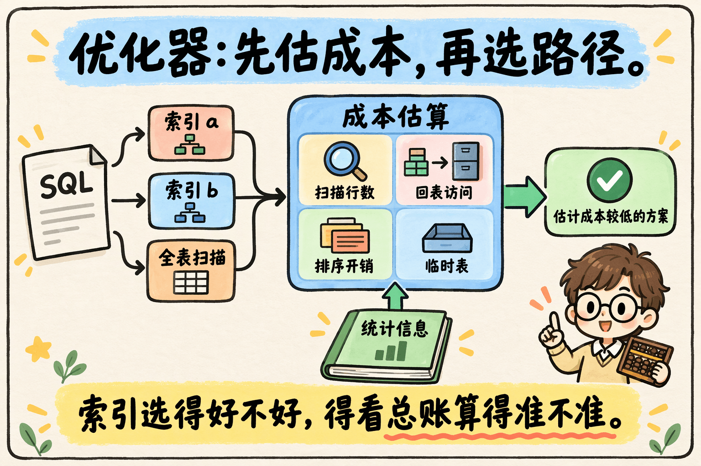
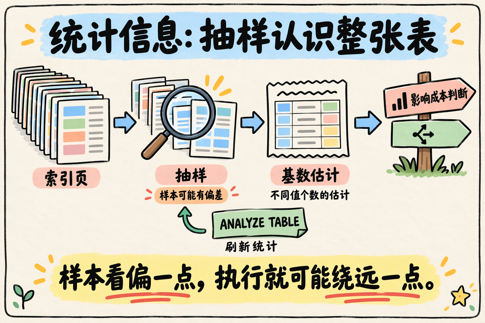
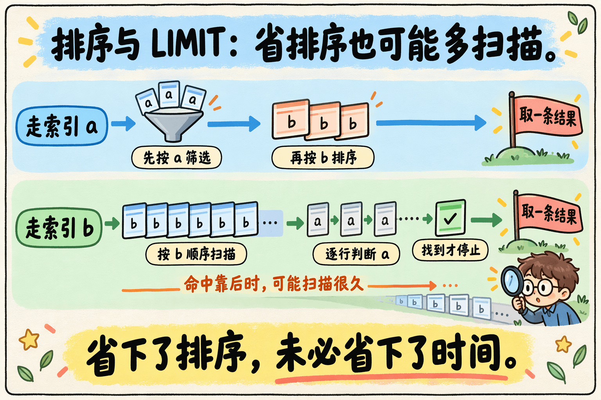
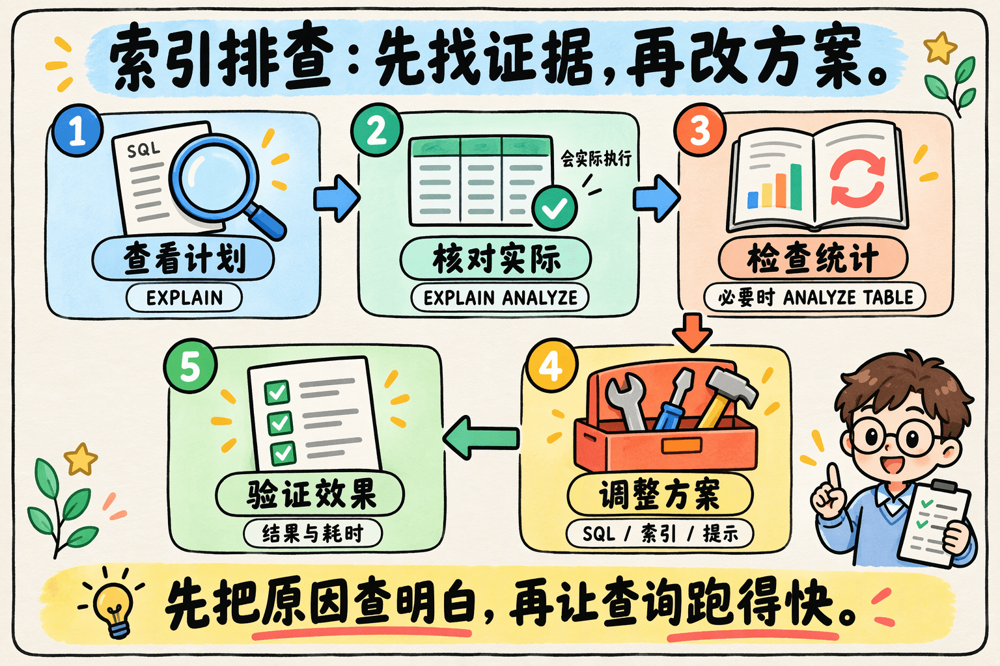

明明建了索引，MySQL 却没有用；或者它用了另一个索引，查询反而更慢。遇到这种情况，很容易怀疑：优化器是不是“选错了”？

问题的关键在于：**优化器选择的是估计成本较低的执行方案，而不是提前执行所有方案，再挑出实际最快的那个。**

只要估算与真实执行之间存在偏差，就可能出现“看起来便宜，跑起来很贵”的情况。理解这一点，才能分清：是统计信息不准、排序策略不合适，还是现有索引确实无法高效完成查询。

> 本文以 InnoDB 为背景，命令和行为主要参考 MySQL 8.0 / 8.4。具体执行计划取决于版本、表结构、数据分布和配置。文中的 SQL 用于解释选择过程，不代表在任意数据集上都能复现同一个计划。

## 一、优化器选索引，到底在算什么？



优化器的工作，是在可行的执行方案之间进行比较。对于一条查询，它可能考虑走某个二级索引，也可能选择全表扫描。

扫描行数是重要因素，但不是全部。它还需要综合考虑：

- **扫描开销**：预计需要访问多少索引记录或数据行。
- **回表开销**：二级索引是否包含所需字段，是否还要根据主键读取完整记录。
- **排序开销**：能否利用索引顺序满足 `ORDER BY`，还是需要额外排序。
- **临时表等开销**：聚合、去重或复杂查询是否需要额外处理。

因此，“扫描行数更少”并不自动等于“执行成本更低”。例如，沿二级索引扫描后反复回表，与直接扫描聚簇索引，访问方式就不一样。数据是否在缓冲池中，也会影响实际耗时。

**优化器算的是一笔总账，索引只是完成查询的路径之一。** 有时没有走索引反而是合理选择，不能仅凭 `EXPLAIN` 中的 `key` 为空就判定优化器出了问题。

## 二、还没执行，扫描行数从哪里来？

### 1. 基数是线索，不是精确答案

在真正执行之前，MySQL 通常不能低成本地精确知道条件会命中多少条记录，只能借助统计信息、索引范围估算等机制判断。

其中一个常见指标是索引的**基数（Cardinality）**，即索引中不同键值数量的估计。可以通过下面的命令查看：

```sql
SHOW INDEX FROM t;
```

观察输出中的 `Cardinality` 列。对于复合索引，不同行对应的是不同索引前缀的基数估计。

在同一张表、相同统计口径下，不同值越多，通常意味着按某个值过滤时更容易缩小范围。但**基数并不能完整描述数据分布**。

例如，同样是“有 100 个不同值”，一种情况是每个值的记录数比较接近，另一种情况则是某个热门值占了大半张表。两者基数相同，查某个具体值时的命中行数却可能相差很大。

所以，不能把“统计信息”简单等同于“索引区分度”，也不能认为基数较大的索引一定适合当前查询。

### 2. InnoDB 为什么使用采样？



如果每次优化查询，都先遍历所有记录做精确统计，那么“决定怎么查”本身就会变得很昂贵。

InnoDB 因此使用抽样方式估计索引统计信息：检查一部分索引页，再据此估计整体情况。**这可以理解为通过样本认识全貌，而不是对每一行做完整普查。**

采样会带来不确定性。样本对整体分布的代表性不足，或者数据已经发生明显变化，都可能让优化器看到的“地图”与真实数据存在偏差。

### 3. 统计信息会更新，但不一定立即更新

`innodb_stats_persistent` 用于控制是否持久化 InnoDB 的索引统计信息。持久化有助于让统计结果跨重启保留，也减少因重新采样引起的计划波动。

在 MySQL 8.4 的持久化统计配置中：

- `innodb_stats_persistent_sample_pages` 控制采样页数，默认值为 `20`，也可按表配置。
- 启用自动重算时，表中超过约 `10%` 的行发生变化，会触发统计信息自动重算。
- 自动重算在后台异步进行，不能理解为“达到阈值的那一刻，所有查询立刻使用新统计”。

怀疑统计信息陈旧或偏差较大时，可以考虑执行：

```sql
ANALYZE TABLE t;
```

它会重新收集相关统计信息。不过，**重新统计不等于获得精确统计，也不保证一定换索引或变快**。执行后仍要比较计划与实际表现；生产环境还要评估表规模和操作影响。

## 三、为什么 ORDER BY 和 LIMIT 容易改变选择？

先补齐示例背景。假设表结构如下，`a`、`b` 分别有一个普通索引：

```sql
CREATE TABLE t (
    id BIGINT PRIMARY KEY,
    a INT NOT NULL,
    b INT NOT NULL,
    payload VARCHAR(200),
    KEY idx_a (a),
    KEY idx_b (b)
) ENGINE = InnoDB;
```

查询希望找到满足两个范围条件、且 `b` 最小的一条记录：

```sql
SELECT *
FROM t
WHERE a BETWEEN 1 AND 1000
  AND b BETWEEN 50000 AND 100000
ORDER BY b
LIMIT 1;
```

为了理解它的取舍，先比较两条可能的执行路径。实际优化器还可能评估其他方案。



### 路径 A：先用 a 缩小范围，再排序

沿 `idx_a` 找出 `a` 在指定范围内的记录，回表并检查 `b` 的条件，再按 `b` 排序，取第一条。

如果 `a` 的条件筛选能力很强，留下的候选记录很少，那么即使需要额外排序，总成本也可能较低。

注意：`a BETWEEN 1 AND 1000` 只是值域范围，**不代表一定扫描 1000 行**。实际记录数取决于数据是否重复、是否缺失以及具体分布。

### 路径 B：沿 b 的顺序找，找到就停

沿 `idx_b` 在指定范围内按 `b` 的顺序扫描，回表检查 `a`。由于已经满足排序要求，找到第一条符合条件的记录就能结束。

这个方案很有吸引力：既可能省掉排序，又可能因为 `LIMIT 1` 很早停止。

问题就在“可能很早”上。

如果符合 `a` 条件的记录集中在扫描范围的后面，或者根本没有符合条件的记录，MySQL 就必须检查很多候选行。优化器预期的“找几条就能停”，实际可能变成“查很久才找到”。

这类偏差与数据分布、多个条件之间的相关性有关，不一定只靠刷新单个索引的统计信息就能解决。

**`LIMIT 1` 限制的是返回行数，并不保证只扫描一行。省掉排序，也不保证总耗时更少。**

## 四、遇到疑似选错索引，按什么顺序排查？



### 1. 先看计划，再核对实际执行

先检查优化器选了哪条路径：

```sql
EXPLAIN
SELECT *
FROM t
WHERE a BETWEEN 1 AND 1000
  AND b BETWEEN 50000 AND 100000
ORDER BY b
LIMIT 1;
```

重点关注：

| 字段 | 用来判断什么 |
| --- | --- |
| `possible_keys` | 哪些索引可能帮助查找记录；不等同于最终一定使用的索引 |
| `key` | 实际选择的索引 |
| `rows` | 预计检查的行数，是估计值 |
| `filtered` | 预计经过表条件过滤后保留的比例 |
| `Extra` | 是否出现 `Using filesort`、`Using temporary` 等额外处理 |

`Using filesort` 表示需要额外排序，**并不直接表示一定发生磁盘排序**；同样，没有它也不代表整个查询就更快。

MySQL 8.0.18 及以上版本还可以使用 `EXPLAIN ANALYZE`，观察执行树中的估计行数、实际行数、循环次数与耗时：

```sql
EXPLAIN ANALYZE
SELECT *
FROM t
WHERE a BETWEEN 1 AND 1000
  AND b BETWEEN 50000 AND 100000
ORDER BY b
LIMIT 1;
```

**`EXPLAIN ANALYZE` 会实际执行查询。** 对耗时长或负载高的查询，应在可控环境中使用，不能把它当作纯粹读取计划的操作。输出中的实际行数还应结合 `loops` 和对应执行节点理解。

排查时不要只问“为什么没用我想要的索引”，更应该问：**哪一步的估计与实际差得最多，哪一步真正消耗了时间？**

### 2. 检查统计信息，必要时重新收集

如果估计行数与实际行数差距很大，尤其是近期发生过大量数据变化，可以检查统计配置，并考虑执行 `ANALYZE TABLE` 后重新观察计划。

如果重新统计后差距仍然明显，就要继续看数据倾斜、条件相关性，以及当前索引能否有效支持查询。不要陷入“慢了就反复 ANALYZE”的循环。

### 3. 用 FORCE INDEX 做有依据的对照

当怀疑另一条路径更快时，可以在相同数据和可比条件下做对照：

```sql
EXPLAIN ANALYZE
SELECT *
FROM t FORCE INDEX (idx_a)
WHERE a BETWEEN 1 AND 1000
  AND b BETWEEN 50000 AND 100000
ORDER BY b
LIMIT 1;
```

`FORCE INDEX` 会限制索引选择，并让优化器把全表扫描视为代价很高的方案。但它不是“无论什么情况都必须使用这个索引”，更不是“整个优化器不再评估成本”；指定索引无法用于查询时，仍可能进行表扫描。

如果对照表明提示索引确实能改善当前查询，它可以成为处理手段。不过，使用时要考虑后续变化：

- 数据量和分布变化后，当前更好的路径可能不再合适。
- 索引名称或表结构调整时，SQL 需要同步维护。
- 不同参数范围可能需要不同计划，不能只测一组条件。

提示索引适合有证据地使用，并持续验证，而不是作为所有慢查询的默认补丁。

### 4. 改写 SQL，先保证结果语义一致

有些改写会影响优化器的成本判断，但“计划变了”不等于“改写正确”。

例如，把 `ORDER BY b` 改成 `ORDER BY b, a`，**不能无条件认为结果等价**：

```sql
ORDER BY b
LIMIT 1;

ORDER BY b, a
LIMIT 1;
```

当多条候选记录具有相同的最小 `b` 时，第一种写法没有规定并列记录之间的顺序；第二种则会进一步选择 `a` 较小的记录。如果业务关心具体返回哪条记录，这个区别就很重要。

新增排序列可能改变可用的有序访问路径，但是否需要排序、最终选择哪个索引，仍取决于索引结构和优化器判断，不能把它当作固定有效的技巧。

同样，也不要机械套用“内层 `LIMIT 100`，外层 `LIMIT 1`”的写法。它可能改变执行计划，却不保证更快；如果外层没有 `ORDER BY`，也不应普遍依赖内层顺序来保证最终返回哪一行。

改写之前应先明确业务真正需要的结果与排序规则，再用执行计划和代表性数据验证。

### 5. 调整索引，要看整套查询负载

如果问题长期存在，应评估是否需要更合适的复合索引、是否能够减少回表，以及是否存在冗余索引。

但不要把“加一个联合索引”当成万能答案。例如，`(a, b)` 按先 `a` 后 `b` 的顺序排列；当 `a` 是范围条件时，通常不能直接提供整个结果集按 `b` 的全局顺序。

删除一个被当前查询误用的索引，也可能改变计划，但它可能正服务于其他 SQL。删除之前，需要结合其他查询、写入开销和业务使用情况判断。支持不可见索引的版本可以将其作为评估工具之一，但仍应做好验证和恢复准备。

**索引优化的目标是让实际业务整体受益，而不只是让某一条 SQL 的计划看起来更顺眼。**

## 五、把“选错索引”拆成三个问题

遇到慢查询时，可以先问自己：

1. **估得准不准？** 统计信息是否陈旧，数据分布和条件相关性是否让行数估算出现偏差？
2. **算得全不全？** 除了扫描行数，是否还要考虑回表、排序、提前停止等因素？
3. **有没有更合适的路？** 当前 SQL 和索引设计，是否真的提供了低成本的执行方案？

优化器并不是看见索引就选，也不是只挑基数最大的索引。它根据手里的信息做成本判断，而这些信息和判断都可能与真实执行存在距离。

真正有效的优化，是先用计划和实测找到这段距离，再决定刷新统计、改写 SQL、调整索引，还是使用提示。**先把原因查明白，再让查询跑得快。**

## 参考资料

- [MySQL 8.4：LIMIT Query Optimization](https://dev.mysql.com/doc/refman/8.4/en/limit-optimization.html)
- [MySQL 8.4：Configuring Persistent Optimizer Statistics Parameters](https://dev.mysql.com/doc/refman/8.4/en/innodb-persistent-stats.html)
- [MySQL 8.4：Index Hints](https://dev.mysql.com/doc/refman/8.4/en/index-hints.html)
- [MySQL 8.4：Obtaining Information with EXPLAIN ANALYZE](https://dev.mysql.com/doc/refman/8.4/en/explain.html#explain-analyze)
- [MySQL 8.4：ORDER BY Optimization](https://dev.mysql.com/doc/refman/8.4/en/order-by-optimization.html)
- [MySQL 8.4：Optimizing Derived Tables](https://dev.mysql.com/doc/refman/8.4/en/derived-table-optimization.html)
