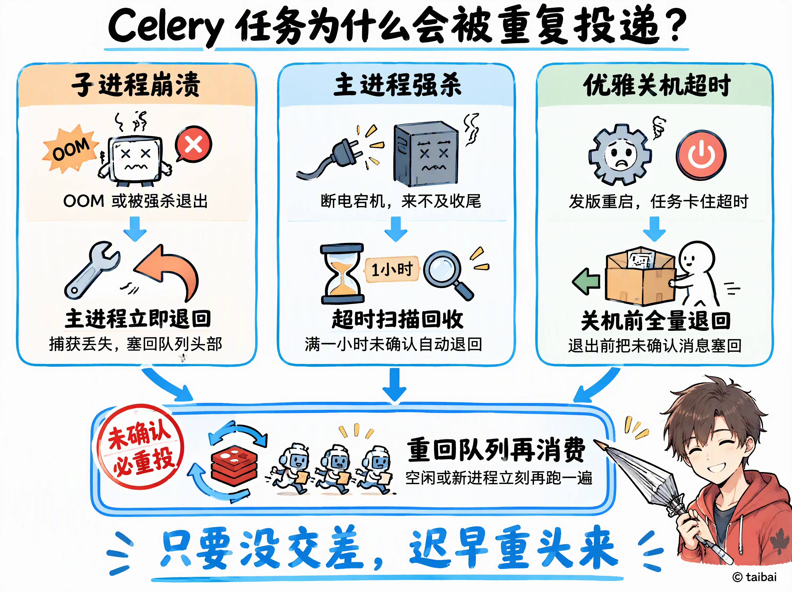

## 文章背景

任务异步化之后，失败和重试不再只是"调用方报错、调用方处理"这么简单：消息一旦被重新投递，同一个任务就可能被执行多次。本文讨论异步处理阶段任务重投的成因，以及在项目中如何应对。

## 为什么会产生任务重投

在 Celery 场景下，任务重投主要来自三种情况。

### 子进程异常退出

- 怎么发生的：主进程还活着，但执行 `process_document` 的子进程非正常退出——比如解析大文件时被 OOM Killer 杀掉（`SIGKILL`）、C 扩展段错误崩溃，或者被人手动 `kill -9 <子进程 PID>`。
- 为什么会重投：主进程捕获到 `WorkerLostError`。因为开启了 `task_reject_on_worker_lost=True`，主进程会立即执行 `reject(requeue=True)`，把 `unacked` 里的消息重新塞回 `celery` 列表头部，其他空闲子进程马上就会取到并再跑一遍。

### 整个进程被强制终止

- 怎么发生的：整机断电、宿主机宕机，或者停机时直接对主进程 `kill -9`，主进程来不及做任何收尾就退出了。
- 为什么会重投：消息还留在 Redis 的 `unacked` 和 `unacked_index` 里。存活或重启后的 Worker 会周期性扫描 `unacked_index`，一旦发现某条消息的时间戳距今超过 `visibility_timeout`（默认 3600 秒，即 1 小时），就把它放回 `celery` 列表重新消费。

### 优雅关机超时，被强制打断

- 怎么发生的：发版或重启 Worker 时发送 `SIGTERM`。Worker 默认会等正在执行的任务跑完，但如果任务卡住、没能在停机时限内结束（或者紧接着收到第二个信号触发冷关机），主进程退出前会触发 Redis 传输层的 `restore_at_shutdown=True`。
- 为什么会重投：主进程在关机的最后一步调用 `restore_unacked()`，把自己尚未 `ack` 的消息全部塞回 `celery` 列表，新启动的 Worker 立刻会再消费一遍。

## 如何处理

应对重投的核心只有一句话：不阻止 Redis 重投，而是让任务本身幂等——同一个 `task_id` 无论执行 1 次还是 N 次，最终结果一致，且已完成任务的状态绝不被改写。

### 项目中的实现

#### 任务入口拦截

读出 `task` 后，先判断状态是否已经是 `STORED` 或 `FAILED`；如果已经是终态，就跳过处理、清理可能残留的临时文件后直接返回。

- 如果上次已经执行完 `finish`（状态为 `STORED`）、但还没删临时文件就退出了，重投进来会清掉残留文件并直接返回，不会再跑第二遍 `add()`。
- 如果上次已经删完临时文件、死在 `ack` 之前，重投进来会在检查 `path.is_file()` 之前直接返回，既不会因为找不到临时文件把 `STORED` 改成 `FAILED`，也不会把原本真实的失败原因（比如「处理超时」）覆盖成「临时文件不存在」。

#### 用 `task_id` 固定 `document_id`，数据库幂等写入

1. 固定文档 ID 与 S3 路径：`document_store.add` 接收 `document_id=task.id`，同一个任务对应的 S3 对象键永远是 `documents/{task.id}/{name}`。
   - 如果上次死在 `objects.put` 之后、`document_orm.insert` 之前，重投再次 `put` 时只是对同一个 S3 键覆盖写入相同内容，不会在 S3 留下无人引用的孤儿文件。
2. `documents` 表幂等插入：`document_orm.insert` 改为 `INSERT IGNORE INTO documents ...`。
   - 如果上次死在 `document_orm.insert` 之后、`task_orm.finish` 之前，重投进来执行 `INSERT IGNORE` 会静默跳过，不会抛 `StorageError`，也就不会触发 `except StorageError: objects.delete(...)` 把已经传好的 S3 文件误删，随后正常执行 `task_orm.finish(task_id, document.id)`，把任务收口为 `STORED`。

## 小结

重投无法被彻底阻止：只要"业务结果落库"和"消息确认"不在同一个原子操作里，就总存在"做完了但没 `ack`"的窗口。能做的，是把窗口两侧都设计成可重复执行——入口先判断终态，写入用固定主键和幂等语句。这样无论消息被投递几次，结果都只有一份。
