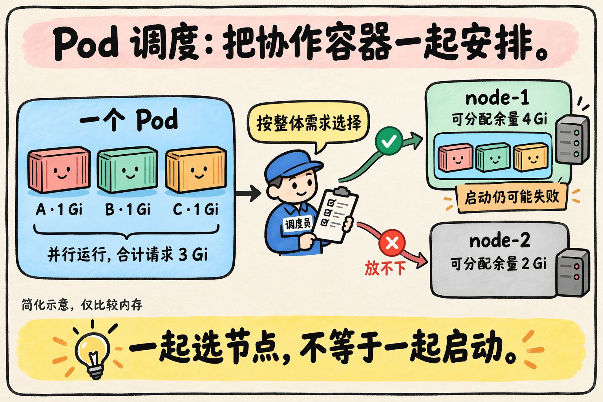
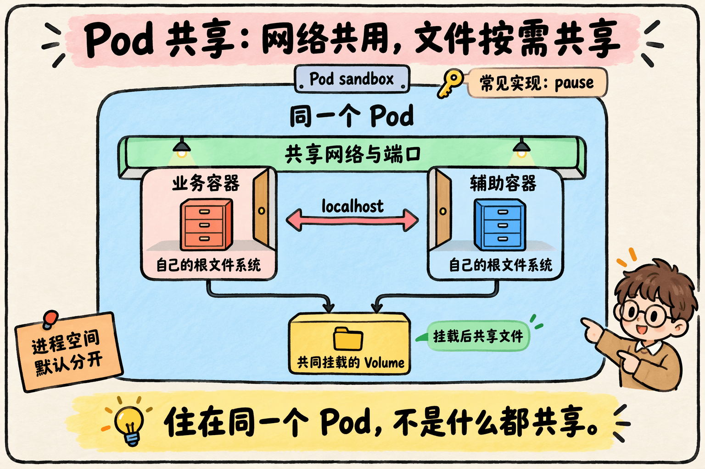
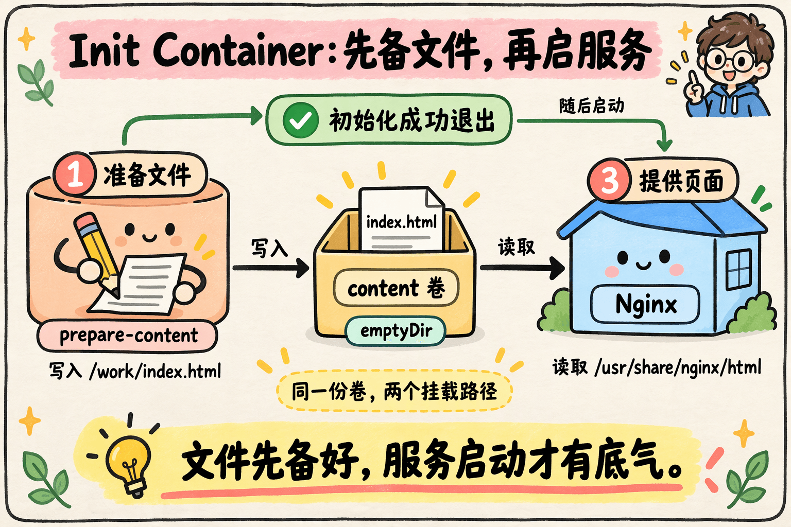
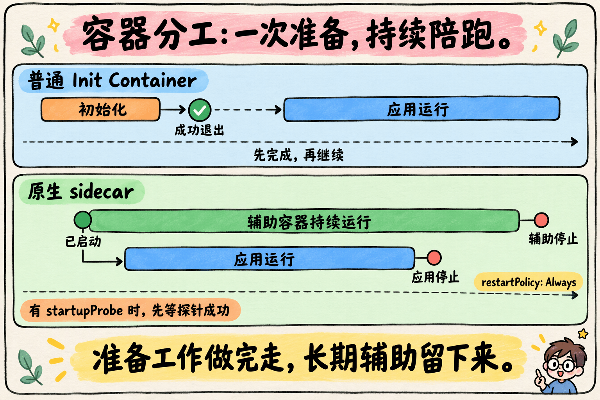
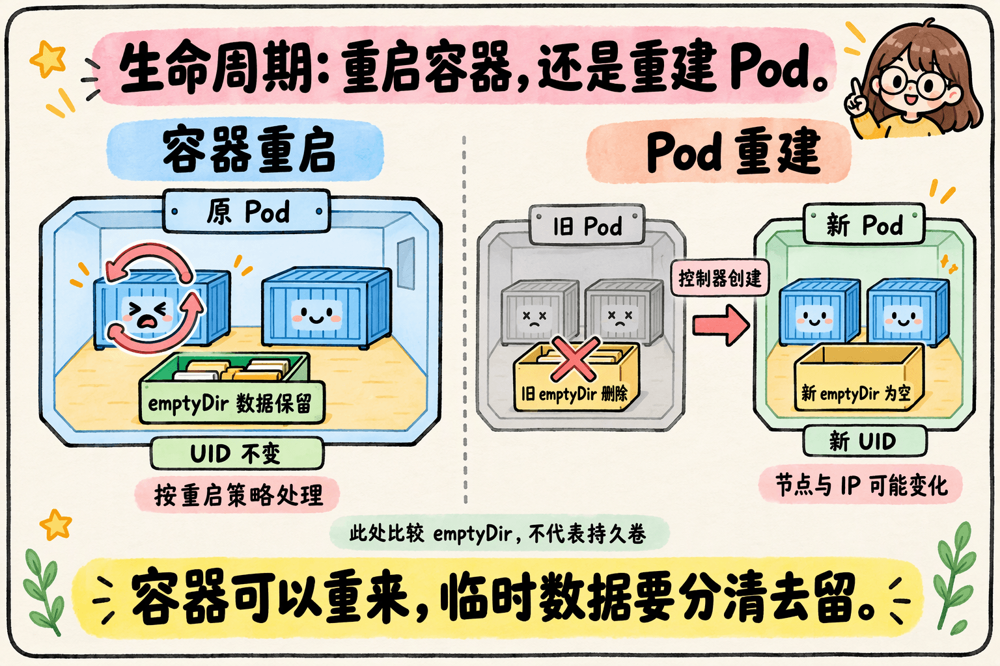

上一篇我们拆解了容器：在常见的 Linux 容器实现中，它并不是一台缩小的虚拟机，而是借助 Namespace、Cgroups 和文件系统等机制隔离与管理的一组进程。

那问题来了：**容器已经能把应用跑起来，Kubernetes 为什么还要在它外面再包一层 Pod？**

先看一个具体需求：一个 Web 服务负责响应请求，另一个程序持续同步它需要的文件。它们最好在同一台机器上，读写同一份目录，还要作为一个整体部署和扩缩容。

如果只告诉平台“启动这两个容器”，剩下的问题就得由你协调：放到哪台节点、怎样共享文件、如何建立本地通信、复制服务时要一起复制哪些组件。

Pod 把这组协作关系明确表达了出来：**哪些容器属于同一个运行单元，应该一起调度，并在约定的范围内共享资源。**

> Pod 是 Kubernetes 中最小的可部署计算单元，可以包含一个或多个容器。单容器 Pod 很常见；只有确实需要紧密协作时，才把多个容器放在一起。

## 一、为什么“一个容器”不总是合适的管理单位？

一个应用不一定对应一个孤立进程。它可能有主进程和工作进程，也可能需要配置同步、日志处理或本地代理等辅助程序。

容器化时，我们通常围绕一个明确职责来组织镜像。例如，让业务镜像专心运行服务，把持续同步文件的逻辑放进另一个镜像。这样，两部分可以各自构建、升级和维护。

但**职责拆开了，不代表运行关系也能完全拆开**。业务服务与文件同步程序仍然需要读取同一份文件，服务扩成两个副本时，通常还希望每个副本都有自己的同步程序。

这就是 Pod 要表达的关系：容器各有职责，平台知道它们应该怎样组合。

这里有两个容易混淆的概念：

- “一个容器一个进程”只是常见的简化说法，不是硬性限制。容器可以运行多个进程，不能据此把一个程序内部的线程机械地拆成多个容器。
- Linux 的进程组主要服务于信号分发和作业控制，不会自动提供共享内存、同机部署或成组调度。Pod 可以类比为“协作单元”，但不能直接等同于进程组。

比起从操作系统概念硬套过来，更好理解的起点是：**这几个组件是否需要作为一个整体被安排和管理？**

## 二、一起调度，解决了什么问题？

假设有三个需要同机运行的容器 A、B、C，每个都声明了 `1 Gi` 的内存请求。

再假设两个节点扣除已有资源请求后，可供调度的内存余量分别为：

| 节点 | 可分配余量 |
| --- | --- |
| node-1 | 4 Gi |
| node-2 | 2 Gi |

如果把三个容器当成互不关联的任务，先放 A，再设法把 B、C 安排到 A 所在的节点，就可能出现这种局面：A、B 已经落到 node-2，C 却放不下；node-1 虽然空间足够，前面的决定却需要重新协调。

这是一个说明调度粒度的简化例子，不代表某个具体调度产品一定会这样决策。

把它们声明为一个 Pod 后，调度器看到的是一个需要整体落到同一节点的对象。在本例中，三个并行容器的请求合计为 `3 Gi`，node-2 不够，node-1 才能满足要求。



需要分清三件事：

1. **调度依据是资源请求与节点可分配资源等条件。** 不是看一眼监控里“当前还剩多少空闲内存”就作决定。
2. **整体调度不等于同时启动成功。** Pod 绑定节点后，仍可能有容器拉镜像失败、初始化失败或启动后崩溃。
3. **Pod 内部一起调度，不等于跨多个 Pod 的任务也会一起调度。** 分布式训练等工作负载所说的 gang scheduling，需要另行考虑成组任务的调度机制。

上面的求和也有前提：只考虑三个并行运行的普通容器，忽略其他资源与开销。真实计算还会涉及 Init Container、原生 sidecar、Pod overhead，以及相应版本的资源配置机制，不能把“所有容器简单相加”当成通用公式。

**Pod 统一的是调度边界，不是把启动过程变成一个要么全成功、要么全回滚的事务。**

## 三、同一个 Pod，究竟共享什么？

只让容器落在同一台节点上还不够。Pod 更有价值的地方，是为它们建立一套明确的共享关系。

本文后面的实现细节，以常见的 Linux 容器运行时和非 `hostNetwork` Pod 为背景。

| 资源 | 默认关系 | 对应用意味着什么 |
| --- | --- | --- |
| 网络命名空间 | 同一个 Pod 内共享 | 可通过 `localhost` 通信，共用 IP 和端口空间 |
| 容器根文件系统 | 各自独立 | A 的文件不会因为同属一个 Pod 就自动出现在 B 中 |
| Pod 声明的 Volume | 容器显式挂载后使用 | 挂载同一卷的容器可以共享其中的数据 |
| 进程命名空间 | 默认不共享 | 不能默认看到其他容器的全部进程，可按需启用共享 |



### 1. 共享网络：localhost 能通，端口也会冲突

例如，业务容器监听 `8080`，辅助容器可以直接请求 `http://localhost:8080`，不必先通过 Service 找到它。

代价是：端口空间也属于同一份网络环境。如果两个容器都想绑定同一个地址和端口，就可能冲突。不能因为“容器不同”，就默认它们都可以各自监听 `0.0.0.0:8080`。

这里常说“一个 Pod 一个 IP”，是对单栈网络的简化。在双栈集群中，Pod 可以同时有 IPv4 和 IPv6 地址。重点是**同一个 Pod 的容器共享网络身份**，而不是永远只有一个地址。

### 2. 共享文件：要挂载同一个卷

假设容器 A 在自己的 `/tmp/result.txt` 写入数据，容器 B 默认看不到它。因为容器有各自的根文件系统，Pod 不会把它们自动合并。

若希望共享文件，应在 Pod 中声明一个 Volume，再让 A、B 都通过 `volumeMounts` 挂载它。挂载路径可以不同，但访问的是同一份卷数据。

卷的生命周期还取决于类型。例如，`emptyDir` 适合同一个 Pod 内的临时数据交换：容器重启时数据通常仍在，Pod 被移除后数据会删除。需要跨 Pod 重建保留的数据，应使用合适的持久化存储。

### 3. 共享环境，不等于“没有隔离”

Pod 内的容器关系紧密，但仍可保留各自的文件系统视图、进程空间和容器级资源限制。

同样，不能因为 Pod 是 API 抽象，就推导出“宿主机上没有 Pod 级 Cgroup”。在常见 Linux 配置下，kubelet 会管理包含 Pod 层级的 Cgroup 结构。

**Pod 是由运行时和内核机制共同支撑的抽象，不只是配置文件里的一个分组标签。**

## 四、Infra 容器在其中做什么？

你可能会想到：既然要共享网络，让容器 B 直接加入容器 A 的网络命名空间，不就行了吗？

这样可以做到共享，却把“谁负责承载这份环境”绑定到了某个业务容器上。平台还得协调它的创建、重启与其他容器的关系。

Kubernetes 通过容器运行时接口 CRI 管理 **Pod sandbox**，为一组容器准备运行环境。常见 Linux 运行时会使用一个很小的基础设施容器，通常称为 Infra 容器或 `pause` 容器，维持共享命名空间等基础环境；业务容器随后加入相应环境。

可以把它理解成先准备公共空间，再让业务组件入住。不过，需要保留几个边界：

- `pause` 是一种常见实现方式，不是要求所有运行时都采用完全相同的实现。
- `pause` 进程不是网络代理。业务流量使用共享网络栈，并不是先交给 `pause` 进程转发。
- 网络命名空间的生命周期由内核引用关系决定，不能简单说“某个业务容器一退出，其他容器的网络立即消失”。

在这种实现中，CNI 插件主要参与 Pod 网络环境的配置，而不需要进入每个业务容器安装网络工具。Volume 的准备和挂载则由 kubelet、运行时及存储相关组件协作完成，**不是由 `pause` 进程负责共享文件**。

至于 `pause` 的具体镜像大小、版本号和实现细节，不影响理解 Pod 的核心设计，也不宜写成永远不变的结论。

## 五、从一个例子看懂 Init Container 和共享卷

先看最简单的协作：启动 Web 服务之前，准备好它要提供的页面文件。

一个普通 Init Container 负责写文件，Nginx 负责读文件。两者共享一个 `emptyDir` 卷：

```yaml
apiVersion: v1
kind: Pod
metadata:
  name: web-with-content
spec:
  initContainers:
    - name: prepare-content
      image: busybox:1.37
      command: ["sh", "-c", "printf 'Hello from the init container!\n' > /work/index.html"]
      volumeMounts:
        - name: content
          mountPath: /work
  containers:
    - name: web
      image: nginx:1.28-alpine
      ports:
        - containerPort: 80
      volumeMounts:
        - name: content
          mountPath: /usr/share/nginx/html
          readOnly: true
  volumes:
    - name: content
      emptyDir: {}
```

这个例子有两条关键关系：

1. **时间关系**：`prepare-content` 成功完成后，`web` 才会启动。多个普通 Init Container 按声明顺序依次执行。
2. **数据关系**：`/work` 和 `/usr/share/nginx/html` 虽然路径不同，但都挂载了 `content` 卷，所以 Nginx 能读到准备好的 `index.html`。



如果把初始化程序改成“复制 WAR 包”，把 Nginx 换成 Tomcat，协作原理仍然一样。

这属于**启动前准备**，不应该把已经执行完并退出的初始化容器，与长期伴随应用运行的 sidecar 混为一谈。

> 示例省略了资源请求、探针和安全配置，用于展示初始化顺序与共享卷。`containerPort` 是端口声明，不会自动把服务暴露到集群外。

## 六、sidecar：把长期辅助职责放到旁边

如果辅助程序只需执行一次，用普通 Init Container 就够了；如果它要在应用运行期间持续工作，就更接近 sidecar 模式。

sidecar 可以理解成“随主容器一起部署的辅助组件”：主容器处理业务，辅助容器持续同步文件、采集特定日志或代理流量。

### 1. 日志与文件同步

例如，业务应用必须把日志写进文件，可以让应用和日志 sidecar 共同挂载日志卷，再由 sidecar 持续读取并转发。

这样，日志处理逻辑能够独立于业务镜像维护。但不必因此给所有应用都增加日志 sidecar：如果应用直接输出到标准输出和标准错误，节点级日志采集通常已经能够处理这类需求。

### 2. 本地流量代理

共享网络还允许辅助容器承担代理职责。以采用 sidecar 模式的服务网格为例，代理和业务容器共享 Pod 网络环境，配合流量重定向机制处理连接、安全与可观测性等功能。

这是 Pod 的一种应用方式，不代表所有服务网格都必须使用 sidecar，也不意味着任何功能都能完全不改应用代码就自动获得。

### 3. 原生 sidecar 与普通 Init Container 的区别

Kubernetes 原生 sidecar 在 **v1.33 进入稳定状态**。它声明在 `initContainers` 中，但为该容器设置 `restartPolicy: Always`。

下面是一个展示写法的片段，业务容器和共享卷定义省略：

```yaml
initContainers:
  - name: log-forwarder
    image: busybox:1.37
    restartPolicy: Always
    command: ["sh", "-c", "tail -n+1 -F /logs/app.log"]
    volumeMounts:
      - name: logs
        mountPath: /logs
```

这里的 `tail` 只演示持续读取日志并输出到标准输出，实际生产中可替换为合适的采集程序。

| 类型 | 适合做什么 | 什么时候继续后续启动流程 |
| --- | --- | --- |
| 普通 Init Container | 一次性准备文件、执行初始化 | 当前容器成功退出后 |
| 原生 sidecar | 持续采集、同步、代理 | 当前容器被认定为已启动后；若配置 `startupProbe`，需探针成功 |
| 普通应用容器 | 执行业务或对等的长期任务 | 不应依赖 `containers` 列表顺序建立启动依赖 |



原生 sidecar **不需要退出**，后续初始化步骤和应用容器就可以继续启动；但如果它始终没能成功启动，仍可能阻塞后续流程。

正常终止 Pod 时，kubelet 会等主应用容器停止后，再按声明的逆序停止这些 sidecar。这个生命周期支持，让“伴随运行”的职责表达得更准确。

“已启动”也不等于“业务已就绪”。应用依赖关系仍需结合启动探针、就绪探针和应用自身的重试机制设计。

## 七、哪些容器该放进同一个 Pod？

判断时，可以问三个问题：

1. **是否需要共享本地环境？** 例如同一份文件、本地端口或本地通信机制。
2. **是否应该一起复制？** 主服务增加一个副本时，是否也需要增加一份辅助组件？
3. **是否接受相同的调度与替换边界？** 能否共同承受同一节点故障、Pod 更新和删除带来的影响？

业务应用和它专属的文件同步程序，往往适合一起部署。Web 应用与共享数据库则通常应该分开，因为二者的状态管理、扩缩容与升级节奏不同。

Pod 中的容器可以使用不同镜像、保留各自资源限制，但通常不能像独立工作负载那样分别增加副本。把本该独立扩缩容的组件绑在一起，会把后续运维也绑住。

**需要通信，只说明它们有联系；需要共享环境并一起复制，才更接近同一个 Pod 的理由。**

## 八、最后分清：容器重启，不等于 Pod 重建

这是理解 Pod 时最容易漏掉的一层。

某个容器崩溃后，kubelet 可以根据重启策略，在原来的 Pod 中重新启动它。此时 Pod 对象通常仍然是同一个，其他容器也不一定跟着重启。

而当 Pod 被删除、驱逐，或者控制器通过创建新 Pod 完成替换时，出现的是一个新的 Pod 对象：UID 不同，可能落到不同节点，IP 也可能变化。Pod 不会以原身份直接“搬家”到另一个节点。



因此：

- 不要把容器的一次重启，描述成所有容器“同生共死”。
- 不要把 Pod IP 当成长期稳定的服务入口；通常应通过 Service 和 DNS 寻址。
- `emptyDir` 可以跨同一个 Pod 内的容器重启保留数据，但不能承担跨 Pod 重建的持久化需求。
- 裸 Pod 不负责自行补副本；长期服务通常交给 Deployment、StatefulSet 等控制器管理。

Pod 的价值，最终落在三个彼此关联的约定上：**一起选择节点，在明确边界内共享资源，作为一个运行单元被控制器管理。**

下一篇再看控制器，就更容易理解：它复制的为什么是整个 Pod，以及滚动更新和故障恢复为什么会带来新的 Pod。

## 参考资料

- 写作启发：张磊《深入剖析 Kubernetes》（极客时间）中关于 Pod、容器组合与应用部署的讲解。本文按官方文档重新梳理了资源共享与生命周期边界。
- [Kubernetes：Pods](https://kubernetes.io/docs/concepts/workloads/pods/)
- [Kubernetes：Pod Lifecycle](https://kubernetes.io/docs/concepts/workloads/pods/pod-lifecycle/)
- [Kubernetes：Init Containers](https://kubernetes.io/docs/concepts/workloads/pods/init-containers/)
- [Kubernetes：Sidecar Containers](https://kubernetes.io/docs/concepts/workloads/pods/sidecar-containers/)
- [Kubernetes：Volumes](https://kubernetes.io/docs/concepts/storage/volumes/)
- [Kubernetes：Resource Management for Pods and Containers](https://kubernetes.io/docs/concepts/configuration/manage-resources-containers/)
- [Kubernetes：Reserve Compute Resources for System Daemons](https://kubernetes.io/docs/tasks/administer-cluster/reserve-compute-resources/)
